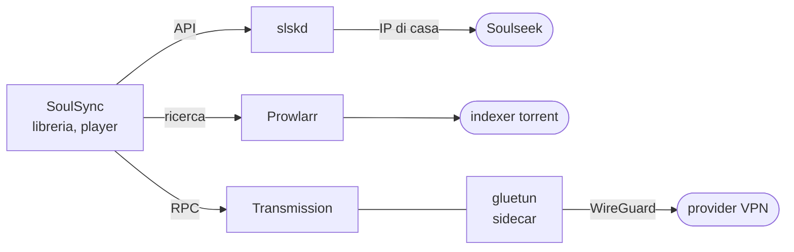

# Applicazioni

Ogni applicazione ha una propria directory sotto
[`apps/`](https://github.com/lucaam/k8s-iannamo/tree/main/apps) e gira solo se
è elencata in `apps/kustomization.yaml`, che la Kustomization `apps` applica.
Quasi tutte sono HelmRelease: la versione del chart è fissata in ogni
`helm-release.yaml` e Renovate propone gli aggiornamenti, quindi questa pagina
non ripete i numeri di versione.

## Applicazioni attive

| App | Namespace | Indirizzo | Login |
|---|---|---|---|
| [Authentik](#authentik) | `authentik` | `auth.${DOMAIN}` | proprio: è l'identity provider |
| [Mosquitto](#mosquitto) | `mqtt` | IP in LAN, porta 1883 | utenti MQTT da un file di password |
| [Zigbee2MQTT](#zigbee2mqtt) | `zigbee2mqtt` | IP in LAN, porta 8080 | nessuno |
| [Home Assistant](#home-assistant) | `home-assistant` | `home.${DOMAIN}`, IP in LAN | proprio |
| [code-server](#home-assistant) per Home Assistant | `home-assistant` | `code-home.${DOMAIN}` | forward auth di Authentik |
| [Matter Server](#matter-server) | `home-assistant-matter-server` | IP in LAN, porta 5580 | nessuno |
| [Immich](#immich) | `immich` | `immich.${DOMAIN}`, IP in LAN | proprio |
| [Gatus](#gatus) | `gatus` | `gatus.${DOMAIN}` | OIDC di Authentik |
| [kube-prometheus-stack](#kube-prometheus-stack) | `prometheus` | `prometheus.${DOMAIN}` | forward auth di Authentik |
| [Grafana](#grafana) | `grafana` | `grafana.${DOMAIN}` | OIDC di Authentik |
| [Servizi esterni](#external-services) | `external-services` | `homelab.${DOMAIN}` | forward auth di Authentik |
| [TREK](#trek) | `trek` | `trek.${DOMAIN}` | OIDC di Authentik |
| [social-media-reuploader](#social-media-reuploader) | `social-media-reuploader` | `social-media-reuploader.${DOMAIN}` | OAuth |
| [SoulSync](#music) | `media` | `soulsync.${DOMAIN}` | forward auth di Authentik, poi il proprio |
| [slskd](#music) | `media` | `slskd.${DOMAIN}` | forward auth di Authentik, poi il proprio |
| [Prowlarr](#music) | `media` | `prowlarr.${DOMAIN}` | forward auth di Authentik, poi il proprio |
| [Transmission](#music) | `media` | `transmission.${DOMAIN}` | forward auth di Authentik, poi il proprio |

Gli hostname finiscono con `${DOMAIN}`, che Flux sostituisce con il dominio
reale. Un IP in LAN è un indirizzo MetalLB che la rete di casa raggiunge
direttamente, senza passare da Traefik: l'elenco è in
[Rete](networking.md#lan-addresses). I tipi di login sono spiegati in
[Sicurezza e segreti](security.md#authentication).

## Identità

### Authentik { #authentik }

- Chart `authentik` da `charts.goauthentik.io`: una replica del server e una
  del worker. Il chart crea anche la HTTPRoute per `auth.${DOMAIN}`.
- L'outpost integrato risponde alle richieste di forward auth di Traefik. La
  route `authentik-outpost` gli manda il path `/outpost.goauthentik.io` di
  ogni host sotto `${DOMAIN}`, così il redirect del login funziona su ogni
  app.
- Database: il PostgreSQL incluso nel chart (subchart Bitnami con l'immagine
  ufficiale `postgres` 17), su `nfs-flash`.
- Segreti: `secret-authentik.sops.yaml` contiene la secret key e le
  credenziali del database e della posta.
- I PVC `authentik-media`, `authentik-certs` e `authentik-templates` non sono
  mai montati dalla release, quindi restano `Pending`.

## Domotica

### Mosquitto { #mosquitto }

- Chart `mosquitto` da `bdclark.github.io/helm-charts`, MQTT sulla
  porta 1883. Il suo IP in LAN è condiviso con Home Assistant.
- I client si autenticano con il file di password del Secret `mqtt-auth`. Il
  chart disattiva l'accesso anonimo quando c'è un file di password, anche se
  nei values c'è `allowAnonymous: true`.
- Dati: `mosquitto-data` su `nfs-spacex`, creato dal chart con
  `helm.sh/resource-policy: keep`.

### Zigbee2MQTT { #zigbee2mqtt }

- Chart `zigbee2mqtt` da `charts.zigbee2mqtt.io`. Il pod è vincolato a
  `talos-homelab-worker-2`, dove l'adattatore USB è in passthrough
  (`/dev/ttyUSB0`, driver `ember`); il container è privilegiato per accedere
  al dispositivo seriale.
- Pubblica su `mosquitto.mqtt.svc.cluster.local:1883`, con il discovery di
  Home Assistant; le credenziali MQTT arrivano dal Secret `mqtt-auth`.
- Il frontend web non ha autenticazione ed è raggiungibile sul suo IP in LAN.
- Dati: `nfs-spacex`, 1 GiB.

### Home Assistant { #home-assistant }

- Chart `home-assistant` (pajikos) da `blog.pavelsklenar.com`. Un solo pod
  (StatefulSet) con la rete dell'host, per il discovery dei dispositivi, e la
  priorità `homelab-critical`.
- Raggiungibile su `home.${DOMAIN}` tramite Traefik e su un IP in LAN (porta
  8080), con il proprio login.
- La release è calibrata sul suo avvio lento: timeout di 15 minuti, tentativi
  di remediation e un grace period di 240 secondi, perché il recorder SQLite
  possa chiudere il database in modo pulito.
- `/config` sta su `home-assistant-home-assistant-0` (`nfs-spacex`,
  ReadWriteMany).
- **code-server** ([`code-server.yaml`](https://github.com/lucaam/k8s-iannamo/blob/main/apps/home-assistant/code-server.yaml))
  modifica la configurazione dal browser. È un Deployment separato che monta lo
  stesso volume `/config`, non apre porte sui nodi ed è raggiungibile solo su
  `code-home.${DOMAIN}`, dietro la forward auth di Authentik. L'addon
  code-server del chart è disattivato.
- Il ServiceMonitor del chart legge `/api/prometheus`, ma in Home Assistant
  l'integrazione Prometheus non è attiva, quindi quel target è down.

### Matter Server { #matter-server }

- Chart `home-assistant-matter-server` da `charts.derwitt.dev`, con l'immagine
  del server matter.js `matter-js/matterjs-server`.
- Home Assistant usa la sua API WebSocket sulla porta 5580; l'API non ha
  autenticazione ed è raggiungibile sul suo IP in LAN.
- Dati: `nfs-spacex`, 2 GiB.

## Media

### Immich { #immich }

- Chart `immich` da `immich-app.github.io/immich-charts`: server, machine
  learning e Valkey.
- Il server è vincolato a `talos-homelab-worker-1` e usa la iGPU (`/dev/dri`,
  container privilegiato) per la transcodifica hardware.
- `immich.${DOMAIN}` passa dal middleware `immich-buffering`, che limita il
  corpo delle richieste a 100 MiB. Sono instradati anche i nomi interni
  `immich` e `immich.lan`, e il server ha anche un IP in LAN per l'API
  (porta 2283) e per le porte delle metriche.
- Database: il cluster CloudNativePG `immich-pg` (due istanze dell'immagine
  PostgreSQL con VectorChord, 32 GiB ciascuna su `nfs-flash`) e il suo oggetto
  `Database`, in `database.yaml`.
- Libreria: `immich-library` su `nfs-spacex` (1 TiB richiesto); cache del
  machine learning e Valkey su `nfs-flash`.
- Immich scrive ogni notte un dump del database dentro la libreria, sullo
  stesso pool delle foto: non è un backup.

### Stack musicale { #music }

Uno stack musicale orientato ai brani nel namespace `media`, fatto di
Deployment semplici (nessuna di queste app ha un chart upstream):
`soulsync.yaml`, `slskd.yaml`, `prowlarr.yaml` e `transmission.yaml` in
`apps/media/`.



- **SoulSync** gestisce la libreria: sincronizza le playlist (Spotify, Tidal
  e altro), cerca su Soulseek tramite slskd e i torrent tramite Prowlarr e
  Transmission, verifica, tagga e archivia ogni brano sotto `/data/music`, e
  lo riproduce con il suo player e i suoi account.
- **slskd** è il client Soulseek. Si collega dall'IP di casa, non ascolta su
  nessuna porta pubblica e non condivide nulla (`SLSKD_SHARED_DIR` non è
  impostato).
- **Prowlarr** contiene gli indexer torrent; invia solo le ricerche.
- **Transmission** manda tutto il suo traffico in un tunnel WireGuard aperto
  da **gluetun**, un sidecar nativo nello stesso pod. Il firewall di gluetun fa
  da kill switch: Transmission parte solo quando il tunnel è attivo, il DNS
  passa dal tunnel, e solo le reti dei pod e dei Service del cluster lo
  aggirano. Non c'è port forwarding attraverso la VPN.
- Storage: un solo volume, `media-data` su `nfs-spacex`, contiene i download
  di entrambi i client e la libreria (`/data/downloads/...`, `/data/music`,
  `/data/staging`), montato da tutte le app con gli stessi path. Ogni app
  tiene configurazione e database SQLite su un proprio volume `nfs-flash`.
  Tutti i Deployment usano `Recreate`, quindi ogni database ha un solo
  scrittore.
- Ogni UI è dietro il middleware `authentik-forward-auth` e mantiene il
  proprio login. Il forward auth funziona in modalità single application,
  quindi ogni hostname ha bisogno di un proprio Proxy Provider in Authentik,
  aggiunto all'outpost embedded; fino ad allora l'outpost rifiuta l'hostname.
- Segreti, cifrati con SOPS: `slskd-secret` (login web, chiave JWT, API key,
  account Soulseek), `transmission-secret` (login RPC) e `gluetun-secret` (il
  tunnel). `gluetun-secret` contiene i valori del `wg0.conf` del provider,
  con il solo indirizzo IPv4: la rete dei pod non ha IPv6 e gluetun rifiuta un
  indirizzo IPv6 sull'interfaccia. `vpn.conf`, il file in chiaro, è nel
  `.gitignore`.

Primo setup, dopo aver creato i provider in Authentik:

1. Prowlarr: crea il login, aggiungi gli indexer, copia l'API key
   (Settings > General).
2. SoulSync: crea l'account admin, poi aggiungi le fonti di download:
   - Soulseek: `http://slskd.media.svc.cluster.local:5030` e la chiave in
     `SLSKD_API_KEY` (la parte dopo l'ultimo `;`);
   - Prowlarr: `http://prowlarr.media.svc.cluster.local:9696` e la sua API key;
   - Transmission: `http://transmission.media.svc.cluster.local:9091` con
     `TRANSMISSION__RPC_USERNAME` e `TRANSMISSION__RPC_PASSWORD`.
3. Spotify, facoltativo: usa il redirect URI `https://soulsync.${DOMAIN}/callback`
   sia in SoulSync sia nell'app Spotify.

Gatus controlla i quattro Service (gruppo "Music").

## Monitoraggio

### Gatus { #gatus }

Chart `gatus` da `twin.github.io/helm-charts`. Pagina di stato su
`gatus.${DOMAIN}` con OIDC di Authentik, controlli di salute con alert su
Telegram, storico in SQLite su `gatus-data`. Vedi
[Monitoraggio](monitoring.md#gatus).

### kube-prometheus-stack { #kube-prometheus-stack }

Chart `kube-prometheus-stack` da `prometheus-community.github.io/helm-charts`:
Prometheus, Alertmanager, il Prometheus Operator, kube-state-metrics e
node-exporter. La UI di Prometheus è su `prometheus.${DOMAIN}`, dietro la
forward auth di Authentik. Vedi [Monitoraggio](monitoring.md#prometheus).

### Grafana { #grafana }

Chart `grafana` da `grafana.github.io/helm-charts`, su `grafana.${DOMAIN}` con
il generic OAuth di Authentik. Il gruppo Authentik `monitoring admins`
corrisponde al ruolo Admin, `monitoring editors` a Editor, tutti gli altri
hanno Viewer. Vedi [Monitoraggio](monitoring.md#grafana).

## Altre app

### Servizi esterni { #external-services }

Pubblica su `homelab.${DOMAIN}`, dietro la forward auth di Authentik, un
servizio web che gira su un altro host della LAN. Non c'è un chart: un Service
senza selector e un oggetto `Endpoints` scritto a mano indirizzano Traefik
verso quell'host.

### TREK { #trek }

- Pianificatore di viaggi. Il chart arriva dal repository Git upstream
  `liketrek/TREK`, fissato a un tag di release; Renovate propone i tag nuovi.
- La GitRepository estrae solo `charts/trek` (`sparseCheckout`): il
  repository completo pesa circa 195 MB, e il source-controller lo
  scompattava a ogni riconciliazione del chart, con scritture pesanti sul pool
  `flash`.
- `trek.${DOMAIN}` con OIDC di Authentik; i membri del gruppo `trip admins`
  sono amministratori di TREK. Dati e upload su `nfs-flash`.

### social-media-reuploader { #social-media-reuploader }

- Un bot Telegram, in modalità polling, che scarica i contenuti linkati in
  una chat (qualsiasi sito supportato da yt-dlp) e ripubblica i file, più una
  GUI di amministrazione su `social-media-reuploader.${DOMAIN}` con login
  OAuth tramite Authentik (redirect URI
  `https://social-media-reuploader.${DOMAIN}/auth`).
- Il chart è il chart OCI firmato che ogni release di
  [lucaam/social-media-reuploader](https://github.com/lucaam/social-media-reuploader)
  pubblica (`oci://ghcr.io/lucaam/charts/social-media-reuploader`), fissato
  alla release che corrisponde al tag dell'immagine; l'`OCIRepository`
  accetta solo chart firmati dal workflow di release. Renovate propone chart
  e immagine insieme.
- Segreti: `social-media-reuploader-secret` (token del bot) e
  `social-media-reuploader-gui-secret` (`SECRET_KEY` e le impostazioni
  `OAUTH_*`), entrambi cifrati con SOPS.
- Dati: il database SQLite `social-media-reuploader-data` su `nfs-flash`,
  creato dal chart con `helm.sh/resource-policy: keep`. Bot e GUI girano
  sullo stesso nodo. Il database usa il rollback journal
  (`SQLITE_JOURNAL_MODE: delete`, `synchronous=FULL`): il WAL, default
  dell'app dalla v0.9.0, richiede storage locale e il cluster ha solo NFS.
- Gli upgrade usano il client-side apply (`upgrade.serverSideApply:
  disabled`): il Deployment del bot usa la strategia Recreate, a cui il
  server-side apply non riesce a passare dal RollingUpdate di default.

## Applicazioni disattivate e dismesse { #disabled }

`ollama`, `open-webui`, `paperless-ngx` e `tado-api-proxy` hanno ancora una
directory sotto `apps/`, ma sono commentate in `apps/kustomization.yaml`. I
loro namespace non esistono più; i file dei loro volumi sono ancora sull'host
NFS, dietro PV `Released`. La CI segnala i loro manifest come orfani, perché
nessuna Kustomization li applica, e Renovate li ignora. Riattivarne una ricrea
i suoi PVC con i vecchi nomi, che corrispondono alle vecchie directory
sull'host NFS: i vecchi dati ricompaiono. Vedi
[Storage](storage.md#volume-directories).

**TeslaMate** è stata dismessa come descritto in
[Dismettere un'app](retiring-an-app.md): parcheggiata con
[#415](https://github.com/lucaam/k8s-iannamo/pull/415), poi rimossa da Git con
[#431](https://github.com/lucaam/k8s-iannamo/pull/431). Il suo namespace, il
cluster CloudNativePG `teslamate-db` in ibernazione e il PVC di Grafana restano
nel cluster fino al 2027-02-26, come registrato in `.github/ci/retention.yaml`.
La sua sorgente non distribuisce più il chart, quindi per riportarla serve un
chart nuovo.

!!! warning "Non disattivare un'app commentandola"
    Togliere un'app da `apps/kustomization.yaml` cancella la sua HelmRelease,
    e Helm cancella poi i PVC creati dal chart, a meno che non abbiano
    `helm.sh/resource-policy: keep`. Segui invece
    [Dismettere un'app](retiring-an-app.md).

## Struttura di una directory di app { #app-layout }

```text
apps/<app>/
├── kustomization.yaml      risorse dell'app
├── namespace.yaml          namespace; le app con stato hanno prune: disabled
├── helm-repository.yaml    sorgente del chart in flux-system (HelmRepository o GitRepository)
├── helm-release.yaml       HelmRelease: versione del chart fissata e values
├── httproute.yaml          route della Gateway API su traefik-gateway (websecure)
├── pvc.yaml                PVC creati da Flux, con prune: disabled (opzionale)
├── secret-*.sops.yaml      Secret cifrati con SOPS (opzionale)
└── middleware-*.yaml       middleware Traefik, per esempio la forward auth di Authentik (opzionale)
```

## Aggiungere un'app

1. Crea `apps/<app>/` con la struttura qui sopra. Fissa la versione del chart,
   che la CI richiede, e dai a ogni immagine un tag o un digest.
2. Annota il Namespace e ogni PVC con
   `kustomize.toolkit.fluxcd.io/prune: disabled`, e imposta il livello di Pod
   Security sul Namespace se l'app ha bisogno di più di `baseline`.
3. Indica la StorageClass in modo esplicito: non ce n'è una di default. Vedi
   [Storage](storage.md#storageclasses).
4. Imposta le request di CPU e memoria e un limite di memoria, ma nessun
   limite di CPU, e una PriorityClass se l'app è critica o può aspettare. Vedi
   [Infrastruttura](infrastructure.md#priority-classes).
5. Metti le credenziali in `secret-<nome>.sops.yaml` e cifra il file prima del
   primo commit. Vedi [Sicurezza e segreti](security.md#sops-and-age).
6. Pubblicala con una HTTPRoute su `traefik-gateway`, listener `websecure`,
   con un hostname coperto dal certificato wildcard. Metti il middleware di
   forward auth davanti alle app senza un login proprio.
7. Aggiungi la directory ad `apps/kustomization.yaml`, aggiungi un controllo a
   Gatus e apri una pull request come descritto in
   [Flusso delle modifiche](workflow.md).
