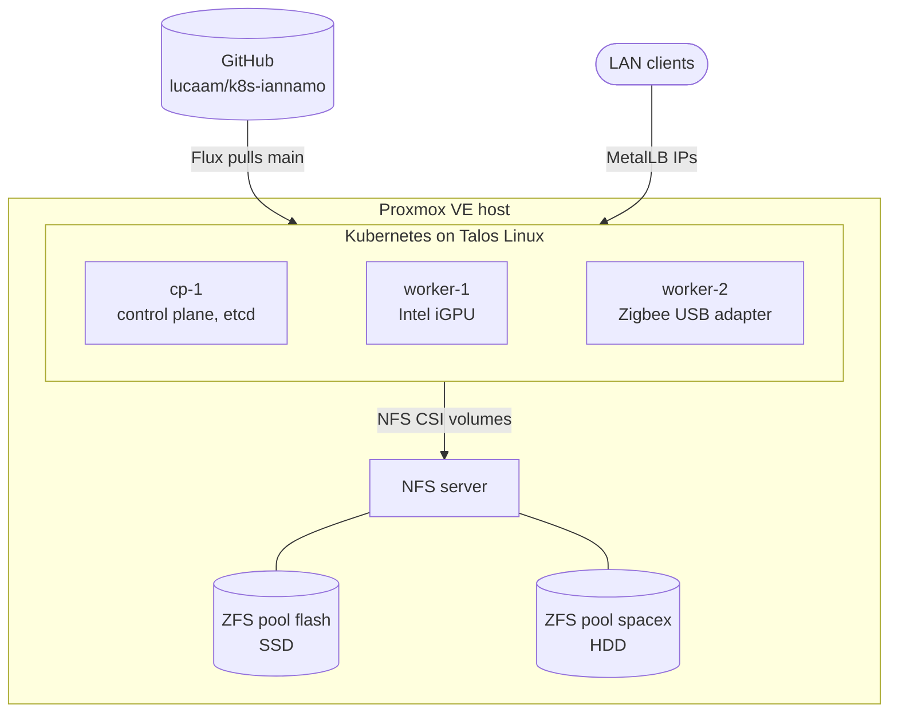
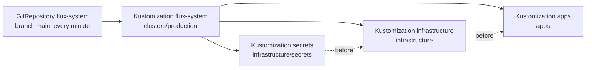
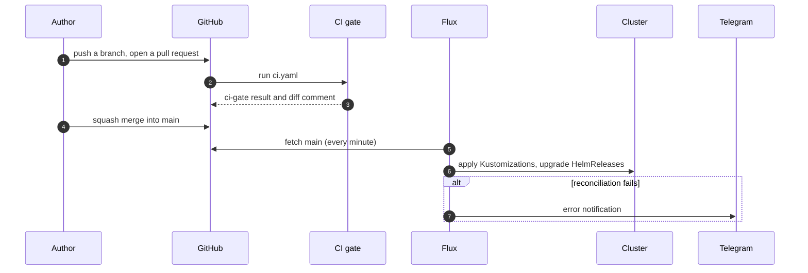

# Architecture

## Overview



Everything runs on a single Proxmox VE host: the three Kubernetes nodes are
virtual machines, and the same host serves the ZFS pools over NFS for the
persistent volumes. Its node-exporter and ZFS exporter are scraped by
Prometheus.

## Nodes

| Node | Role | vCPU | RAM | Passed-through device |
|---|---|---|---|---|
| `talos-homelab-cp-1` | control plane | 4 | 4 GiB | – |
| `talos-homelab-worker-1` | worker | 4 | 12 GiB | Intel iGPU |
| `talos-homelab-worker-2` | worker | 4 | 12 GiB | USB Zigbee adapter |

- The control plane node is the only etcd member and runs only system pods
  (control-plane taint).
- On `talos-homelab-worker-1`, Immich uses the iGPU (`/dev/dri`) for
  transcoding. The Talos image of this node adds the `i915` and `intel-ucode`
  extensions.
- On `talos-homelab-worker-2`, the Zigbee adapter is `/dev/ttyUSB0`, used by
  Zigbee2MQTT.

The VM disks are files on the `flash` pool, the same SSDs that back the
`nfs-flash` volumes. Heavy writes to those volumes slow down etcd, and slow
etcd writes make the controller manager and the scheduler lose their leader
election and restart.

## Software layers

- **Talos Linux** is an immutable operating system driven by an API: no SSH,
  no package manager, the whole node configuration is a machine config applied
  with `talosctl`. The VMs and the Talos machine configs are managed with
  Terraform in a separate, private repository; this repository starts at the
  Kubernetes layer.
- **Kubernetes** keeps the Talos defaults: flannel as CNI, kube-proxy, and
  CoreDNS, whose configuration this repository overrides (see
  [Networking](networking.md#dns)).
- **Flux** reconciles this repository into the cluster.

## GitOps with Flux { #gitops-with-flux }



The GitRepository `flux-system` fetches `main` every minute. The Kustomization
`flux-system` applies `clusters/production`, which defines the three
Kustomizations that apply the rest of the repository:

| Kustomization | Path | Depends on | Prune | SOPS decryption | postBuild variables from |
|---|---|---|---|---|---|
| `secrets` | `infrastructure/secrets` | – | no | yes | – |
| `infrastructure` | `infrastructure` | `flux-system`, `secrets` | yes | yes | `cluster-vars`, `telegram-credentials` |
| `apps` | `apps` | `infrastructure` | yes | yes | `cluster-vars`, `telegram-credentials` |

- All three reconcile every 10 minutes and set `deletionPolicy: Orphan`:
  deleting one of these Kustomization objects leaves what it applied in the
  cluster.
- With prune enabled, Flux deletes the objects that disappear from Git, except
  the ones annotated `kustomize.toolkit.fluxcd.io/prune: disabled`: PVCs,
  namespaces of stateful apps, CloudNativePG clusters and CRDs. See
  [Storage](storage.md#data-protection).
- `dependsOn` only orders the applies. A Kustomization is ready as soon as its
  objects are applied: none of them uses `wait` or health checks, so `apps`
  does not wait for the HelmReleases of `infrastructure` to be healthy.
- Each Kustomization is applied as one set, after a server-side dry run: a
  single invalid object stops the whole Kustomization.
- `infrastructure` and `apps` substitute `${DOMAIN}` and
  `${TELEGRAM_BOT_TOKEN}` from the two Secrets applied by `secrets`. See
  [Security and secrets](security.md#postbuild-variables).

!!! warning "Flux itself is not managed from Git"
    `clusters/production/kustomization.yaml` does not include `flux-system/`,
    so Flux never applies `gotk-components.yaml` and `gotk-sync.yaml`. The
    controllers in the cluster (Flux v2.8) were installed with the `flux` CLI.
    The `gotk-components.yaml` in Git is newer (v2.10) and has no effect, and
    Renovate ignores the directory. Flux 2.8 already expects Kubernetes 1.33
    or later (`flux check` reports the mismatch), so self-management waits for
    the Kubernetes upgrade.

Two Secrets were created outside Git when the cluster was bootstrapped, and
this repository does not contain them:

- `flux-system/flux-system`: the credentials the GitRepository uses to fetch
  this repository;
- `flux-system/sops-age`: the age private key (`age.agekey`) that decrypts the
  SOPS files.

Rebuilding the cluster from this repository alone has never been tested.
Besides Flux and those two Secrets, the CRDs of Traefik and of the Prometheus
Operator are not in Git: both HelmReleases skip CRDs, and the CRDs in the
cluster come from earlier installs.

## From commit to cluster



The details of each step are in [Change workflow](workflow.md).

## Repository layout

```text
clusters/production/       Flux entry point
├── flux-system/           Flux install manifests (not applied from Git, see above)
├── secrets.yaml           Kustomization "secrets"
├── infrastructure.yaml    Kustomization "infrastructure"
└── apps.yaml              Kustomization "apps"
infrastructure/            platform components, see Infrastructure
├── crds/                  Gateway API CRDs, CloudNativePG operator and CRDs
├── priority-classes/      homelab PriorityClasses
├── metallb/               load balancer and address pool
├── cert-manager/          ClusterIssuer and wildcard certificate
├── nfs-csi/               NFS CSI driver and StorageClasses
├── traefik/               Traefik, Gateway, middlewares, error pages
├── kube-system/           CoreDNS configuration
├── notifications/         Flux alerts to Telegram
└── secrets/               SOPS Secrets for postBuild substitution
apps/                      one directory per application, see Applications
policy/                    conftest policies used by CI
hack/                      read-only helper scripts
.github/                   CI workflows, fluxci, Renovate configuration
docs/, mkdocs.yml          this site
mise.toml                  tool versions for CI and local runs
```
