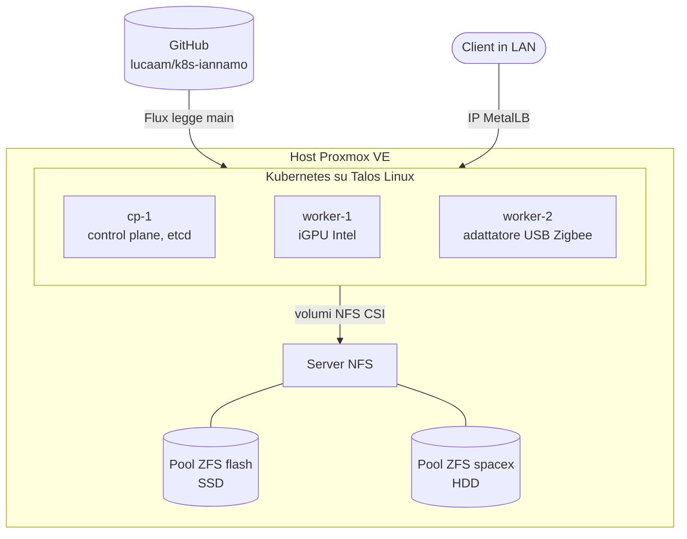
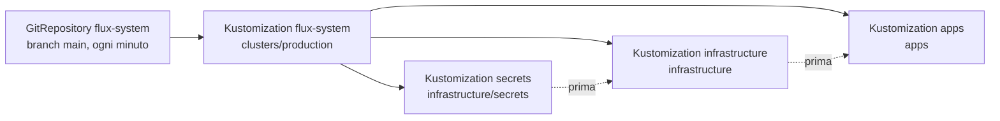
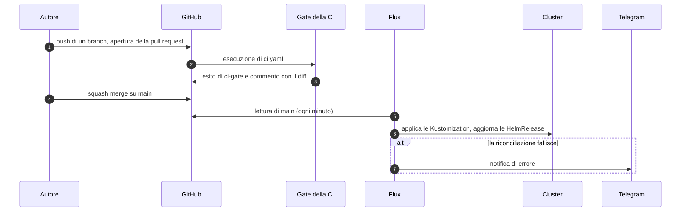

# Architettura

## Panoramica



Tutto gira su un unico host Proxmox VE: i tre nodi Kubernetes sono macchine
virtuali, e lo stesso host serve via NFS i pool ZFS per i volumi persistenti.
Prometheus raccoglie le metriche del suo node-exporter e del suo exporter ZFS.

## Nodi

| Nodo | Ruolo | vCPU | RAM | Dispositivo in passthrough |
|---|---|---|---|---|
| `talos-homelab-cp-1` | control plane | 4 | 4 GiB | – |
| `talos-homelab-worker-1` | worker | 4 | 12 GiB | iGPU Intel |
| `talos-homelab-worker-2` | worker | 4 | 12 GiB | adattatore USB Zigbee |

- Il nodo di control plane è l'unico membro etcd ed esegue solo pod di
  sistema (taint di control plane).
- Su `talos-homelab-worker-1`, Immich usa la iGPU (`/dev/dri`) per la
  transcodifica. L'immagine Talos di questo nodo aggiunge le estensioni `i915`
  e `intel-ucode`.
- Su `talos-homelab-worker-2`, l'adattatore Zigbee è `/dev/ttyUSB0`, usato da
  Zigbee2MQTT.

I dischi delle VM sono file sul pool `flash`, gli stessi SSD che ospitano i
volumi `nfs-flash`. Le scritture pesanti su quei volumi rallentano etcd, e le
scritture lente di etcd fanno perdere la leader election a controller manager
e scheduler, che si riavviano.

## Livelli software

- **Talos Linux** è un sistema operativo immutabile, gestito tramite API:
  niente SSH, niente package manager, tutta la configurazione del nodo è una
  machine config applicata con `talosctl`. Le VM e le machine config di Talos
  sono gestite con Terraform in un repository separato e privato; questo
  repository parte dal livello Kubernetes.
- **Kubernetes** mantiene i default di Talos: flannel come CNI, kube-proxy e
  CoreDNS, la cui configurazione è sovrascritta da questo repository (vedi
  [Rete](networking.md#dns)).
- **Flux** riconcilia questo repository nel cluster.

## GitOps con Flux { #gitops-with-flux }



La GitRepository `flux-system` legge `main` ogni minuto. La Kustomization
`flux-system` applica `clusters/production`, che definisce le tre
Kustomization che applicano il resto del repository:

| Kustomization | Path | Dipende da | Prune | Decifratura SOPS | Variabili postBuild da |
|---|---|---|---|---|---|
| `secrets` | `infrastructure/secrets` | – | no | sì | – |
| `infrastructure` | `infrastructure` | `flux-system`, `secrets` | sì | sì | `cluster-vars`, `telegram-credentials` |
| `apps` | `apps` | `infrastructure` | sì | sì | `cluster-vars`, `telegram-credentials` |

- Tutte e tre si riconciliano ogni 10 minuti e impostano
  `deletionPolicy: Orphan`: cancellare uno di questi oggetti Kustomization
  lascia nel cluster ciò che aveva applicato.
- Con il prune attivo, Flux cancella gli oggetti che spariscono da Git, tranne
  quelli annotati `kustomize.toolkit.fluxcd.io/prune: disabled`: PVC,
  namespace delle app con stato, cluster CloudNativePG e CRD. Vedi
  [Storage](storage.md#data-protection).
- `dependsOn` ordina soltanto le applicazioni. Una Kustomization è pronta non
  appena i suoi oggetti sono applicati: nessuna usa `wait` o health check,
  quindi `apps` non aspetta che le HelmRelease di `infrastructure` siano sane.
- Ogni Kustomization viene applicata come un unico insieme, dopo un dry run
  lato server: basta un oggetto non valido per bloccare l'intera
  Kustomization.
- `infrastructure` e `apps` sostituiscono `${DOMAIN}` e `${TELEGRAM_BOT_TOKEN}`
  con i valori dei due Secret applicati da `secrets`. Vedi
  [Sicurezza e segreti](security.md#postbuild-variables).

!!! warning "Flux stesso non è gestito da Git"
    `clusters/production/kustomization.yaml` non include `flux-system/`,
    quindi Flux non applica mai `gotk-components.yaml` e `gotk-sync.yaml`. I
    controller nel cluster (Flux v2.8) sono stati installati con la CLI
    `flux`. Il `gotk-components.yaml` in Git è più recente (v2.10) e non ha
    effetto, e Renovate ignora la directory. Flux 2.8 richiede già
    Kubernetes 1.33 o successivo (`flux check` segnala la differenza), quindi
    l'autogestione aspetta l'upgrade di Kubernetes.

Due Secret sono stati creati fuori da Git al bootstrap del cluster, e questo
repository non li contiene:

- `flux-system/flux-system`: le credenziali con cui la GitRepository legge
  questo repository;
- `flux-system/sops-age`: la chiave privata age (`age.agekey`) che decifra i
  file SOPS.

La ricostruzione del cluster partendo solo da questo repository non è mai
stata provata. Oltre a Flux e a quei due Secret, mancano in Git le CRD di
Traefik e del Prometheus Operator: entrambe le HelmRelease saltano le CRD, e
quelle nel cluster vengono da installazioni precedenti.

## Dal commit al cluster



I dettagli di ogni passo sono in [Flusso delle modifiche](workflow.md).

## Struttura del repository

```text
clusters/production/       punto di ingresso di Flux
├── flux-system/           manifest di installazione di Flux (non applicati da Git, vedi sopra)
├── secrets.yaml           Kustomization "secrets"
├── infrastructure.yaml    Kustomization "infrastructure"
└── apps.yaml              Kustomization "apps"
infrastructure/            componenti di piattaforma, vedi Infrastruttura
├── crds/                  CRD della Gateway API, operatore e CRD di CloudNativePG
├── priority-classes/      PriorityClass dell'homelab
├── metallb/               load balancer e pool di indirizzi
├── cert-manager/          ClusterIssuer e certificato wildcard
├── nfs-csi/               driver NFS CSI e StorageClass
├── traefik/               Traefik, Gateway, middleware, pagine di errore
├── kube-system/           configurazione di CoreDNS
├── notifications/         alert di Flux verso Telegram
└── secrets/               Secret SOPS per la sostituzione postBuild
apps/                      una directory per applicazione, vedi Applicazioni
policy/                    policy conftest usate dalla CI
hack/                      script di supporto, in sola lettura
.github/                   workflow della CI, fluxci, configurazione di Renovate
docs/, mkdocs.yml          questo sito
mise.toml                  versioni dei tool per la CI e per l'uso in locale
```
