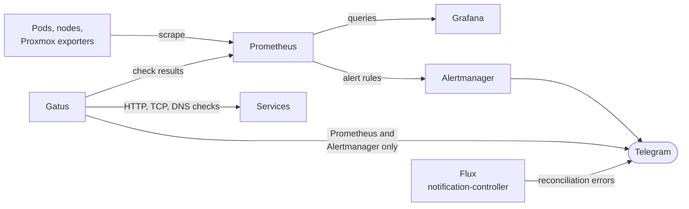

# Monitoring and alerting

Telegram gets three kinds of messages:

| Source | Fires on | Configured in |
|---|---|---|
| Alertmanager | Prometheus alert rules, Gatus checks included (`EndpointDown`) | routing in `apps/prometheus/helm-release.yaml`, rules in `apps/prometheus/prometheusrule-*.yaml` |
| Gatus | Prometheus or Alertmanager not answering, the path every other alert depends on | `apps/gatus/configmap-template.yaml` |
| Flux | `error` events of Flux objects | `infrastructure/notifications/` |

## Prometheus { #prometheus }

kube-prometheus-stack runs in the `prometheus` namespace; its UI is at
`prometheus.${DOMAIN}`, behind Authentik forward auth.

- **Retention**: 30 days or 18 GB, on a 20Gi `nfs-flash` volume.
- **Discovery**: ServiceMonitors, PodMonitors, PrometheusRules and Probes are
  picked up from every namespace, without a label selector.
- **Components**: Prometheus, Alertmanager, the Prometheus Operator,
  kube-state-metrics and node-exporter. The chart's Grafana is disabled:
  Grafana is [a separate app](#grafana).
- **Not scraped**: kube-proxy, kube-controller-manager, kube-scheduler and
  etcd. Talos does not expose their metrics by default, so their monitors are
  disabled to avoid permanent `TargetDown` alerts.
- **CRDs**: the release uses `crds: CreateReplace`, so the Prometheus
  Operator CRDs are upgraded together with the chart.

| Job | Target | Defined by |
|---|---|---|
| `apiserver`, `kubelet`, `coredns`, `kube-state-metrics`, `node-exporter` | the cluster and its nodes | chart defaults, like the jobs of the stack itself |
| `proxmox-node-exporter` | node-exporter on the Proxmox host, port 9100 | Service and manual Endpoints in `apps/prometheus/` |
| `proxmox-zfs-exporter` | ZFS exporter on the Proxmox host, port 9134 | Service and manual Endpoints in `apps/prometheus/` |
| `cert-manager` | cert-manager controller | ServiceMonitor in `apps/prometheus/` |
| `gatus` | Gatus | ServiceMonitor in `apps/gatus/` |
| `authentik-server-metrics` | Authentik | Authentik chart |
| `server` | Immich server | Immich chart |
| `home-assistant` | Home Assistant `/api/prometheus` | Home Assistant chart; off, because the Prometheus integration is not enabled in Home Assistant (`/api/prometheus` answers 404) |

## Alert rules { #alert-rules }

### Severity

Every alert has one of four severities, which decide whether and how it
reaches Telegram:

| Severity | Meaning | Telegram |
|---|---|---|
| `critical` | users or data are affected now: a node, an ingress path, Home Assistant, Authentik, Immich, the shop, a ZFS pool | with sound, at any hour; repeated every 4 hours |
| `warning` | degraded, to fix within a day: crash loops, failed jobs, OOM kills, expiring certificates, internal checks | silent, only 07:00-22:00 UTC (08:00-23:00 in Italy in winter); a warning raised at night arrives in the morning if it still fires; repeated every 24 hours |
| `info` | context: CPU usage, throttling, API server SLO burn, overcommit | none, Alertmanager UI only |
| `none` | `Watchdog`, `InfoInhibitor`, `RolloutInProgress` | none |

### Rules

The default rules of the chart are the base; `defaultRules` and
`customRules` in `apps/prometheus/helm-release.yaml` change them:

| Default rule | Change | Why |
|---|---|---|
| `KubeNodeNotReady` | `critical`, 5 minutes | a node down takes its pods with it; cordoned nodes (drains, Talos upgrades) are ignored |
| `KubeNodePressure` | `warning` (was `info`) | the kubelet is evicting pods |
| `KubeAPIErrorBudgetBurn` | `info` | fired for days because of the known etcd latency |
| `KubeCPUOvercommit`, `KubeMemoryOvercommit` | `info` | capacity planning |
| `NodeFilesystemAlmostOutOfSpace`, `NodeClockSkewDetected` | disabled | the custom rules below also cover the Proxmox host |
| `KubePersistentVolumeFillingUp`, `KubePersistentVolumeInodesFillingUp` | disabled | every PVC is on NFS and reports the free space of the whole dataset: one full pool fired once per PVC |

The custom PrometheusRules in `apps/prometheus/` cover what the defaults
miss:

| File | Alerts |
|---|---|
| `prometheusrule-cluster.yaml` | `NodeMemoryPressure` (pressure stall information, so the Proxmox host at 90% memory by design does not fire), `NodeFilesystemAlmostFull` (`warning` below 10% free, `critical` below 5%), `NodeClockSkew`, `ContainerOOMKilled`, `CertManagerCertExpiringSoon` (`warning` below 14 days, `critical` below 7), `CertManagerCertNotReady`, `AlertSourceDown` (kube-state-metrics or Gatus down: the alerts built on them cannot fire) |
| `prometheusrule-zfs-storage.yaml` | `ZfsPoolNotHealthy`, `ZfsPoolAlmostFull` (`warning` above 80%, `critical` above 90%), `NfsTimeouts`, `NfsServerUnreachable` |
| `prometheusrule-endpoints.yaml` | `EndpointDown`: a Gatus check failing for 5 minutes, with the severity and namespace set on the endpoint (see [Gatus](#gatus)) |
| `prometheusrule-rollouts.yaml` | `RolloutInProgress`: the update window, see below |

### Update window { #update-window }

An update, from a Renovate or a manual pull request, restarts pods: for a
few minutes health checks fail, pods are not ready and targets disappear.
`RolloutInProgress` fires for a namespace while:

- a Deployment, StatefulSet or DaemonSet in it changed generation in the
  last 15 minutes;
- a pod not owned by a Job was created in the last 15 minutes (CloudNativePG
  replaces its pods without a StatefulSet);
- a Deployment or StatefulSet that changed generation in the last 30 minutes
  is still not fully available (slow image pulls).

While it fires, Alertmanager inhibits the availability alerts of that
namespace (`EndpointDown`, `TargetDown`, `KubePodNotReady`,
`KubePodCrashLooping`, `KubeContainerWaiting`, the replica and generation
mismatches); during an update of `traefik`, `metallb` or `kube-system` every
`EndpointDown` is inhibited. If the update leaves something broken, the alert
is sent as soon as the window closes. Never inhibited, because they are how a
failed update shows up: `KubeDeploymentRolloutStuck`,
`KubeStatefulSetUpdateNotRolledOut`, `KubeDaemonSetRolloutStuck`,
`KubeJobFailed`, `ContainerOOMKilled` and the Flux errors.

Over the 30 days before the change, every Gatus outage of 5 minutes or more
was inside an update window, apart from a check with a wrong condition that
has since been fixed.

## Alertmanager

- The routing, the receivers and the message template are in plain text in
  the values of `apps/prometheus/helm-release.yaml` (`alertmanager.config`
  and `alertmanager.templateFiles`). Only the bot token and the chat id are
  secret: `apps/prometheus/secret-alertmanager-telegram.sops.yaml`, mounted
  under `/etc/alertmanager/secrets/alertmanager-telegram/` and read with
  `bot_token_file` and `chat_id_file`. Alertmanager uses its own bot, not the
  one of Flux and Gatus.
- Alerts are grouped by alert name and namespace; `EndpointDown` by alert
  name only, so an ingress outage is one message.
- A critical alert inhibits the warning of the same alert on the same object.
- To mute something by hand, for example during maintenance on Proxmox,
  create a silence in the Alertmanager UI
  (`kubectl -n prometheus port-forward svc/kube-prometheus-stack-alertmanager 9093`).
- Notification history is kept for 7 days on a 2Gi `nfs-flash` volume.
- `Watchdog`, the alert that always fires, is routed to the `null` receiver.
  The dead man's switch is prepared but not active: the steps to send it to
  an external heartbeat service are in the comments of
  `apps/prometheus/helm-release.yaml`. Until then, nothing notices when the
  whole cluster is down.

## Grafana { #grafana }

- `grafana.${DOMAIN}`, login with Authentik generic OAuth; Authentik groups
  map to Grafana roles (see [Applications](apps.md#grafana)).
- The Prometheus datasource is provisioned by the chart values.
- Admin credentials and the OAuth client are in two SOPS Secrets.
- Data, a SQLite database, on `grafana-storage` (`nfs-spacex`); like Gatus,
  the Deployment uses the `Recreate` strategy.
- The dashboards in `apps/grafana/grafana-dashboards/` (Kubernetes resources,
  node-exporter, ZFS) are ConfigMaps labelled `grafana_dashboard: "1"`, but the
  chart's dashboard sidecar is disabled, so Grafana does not load them.

## Gatus { #gatus }

- Status page at `gatus.${DOMAIN}`, login with Authentik OIDC.
- History in SQLite on `gatus-data` (`nfs-spacex`); the Deployment uses the
  `Recreate` strategy, so two pods never write the same database file.
- The OIDC and Telegram credentials come from the `gatus-secrets` Secret as
  environment variables; the configuration refers to them as `$${VAR}`.
- Gatus notifies Telegram directly only for Prometheus and Alertmanager
  (group `Alerting`, after 3 failed checks in a row). Every other endpoint
  has two `extra-labels` that Gatus adds to its metrics: `severity`
  (`critical`, `warning` or `info`, which is never notified) and
  `target_namespace`. `EndpointDown` turns a check failing for 5 minutes into
  an Alertmanager alert in that namespace, so it follows the severity routing
  and the [update window](#update-window).

| Group | Checks | Severity |
|---|---|---|
| Public Services | Authentik, Gatus, Home Assistant, Immich and the Merlo Fiorillo shop through Traefik: status 200, response time, certificate valid for more than 14 days. The shop also accepts the 302 to the installer that an empty WordPress returns | `critical`; Gatus `warning` |
| Gateway | Traefik Service and MetalLB address: both must answer `301` (HTTP to HTTPS) | `critical` |
| Auth | Authentik server, embedded outpost (`/outpost.goauthentik.io/ping`), PostgreSQL port | `critical`; outpost `warning` |
| Home Automation | Home Assistant, Mosquitto, Zigbee2MQTT and a LED panel on the LAN | `critical`; LED panel `info` |
| Immich | server, machine learning, PostgreSQL, Valkey | `critical`; machine learning `warning` (search and faces stop, photos and uploads work) |
| Merlo Fiorillo Shop | MariaDB port | `critical` |
| Music | SoulSync, slskd and Prowlarr health endpoints; Transmission answering `401` through the gluetun firewall | `warning` |
| Cluster Core | CoreDNS | `critical` |
| Infrastructure | cert-manager and its webhook, MetalLB webhook, CloudNativePG webhook | `warning` |
| Alerting | Prometheus and Alertmanager `/-/healthy` | direct Telegram alert |
| External | Cloudflare DNS, GitHub, Docker Hub | `info` |

Hosts without a route get a real 404 from the Traefik catch-all, so a check
that expects 200 fails when a route disappears.

## Flux notifications { #flux-notifications }

- The Alert `flux-failures` in `flux-system` forwards the `error` events of
  every GitRepository, OCIRepository, HelmRepository, HelmChart and
  Kustomization, and of the HelmReleases, to the Provider `telegram`.
- An event source without a namespace only matches `flux-system`, and the
  namespace takes no wildcard: the Alert lists the namespace of every
  HelmRelease. **A new app with a HelmRelease must add its namespace there**,
  or its failed upgrades never reach Telegram (until this change, no
  HelmRelease failure did).
- `waiting.*retrying` and `Health check passed` messages are dropped.
- The Provider spec is SOPS-encrypted; the bot token reaches the Secret
  `telegram-bot` through the `${TELEGRAM_BOT_TOKEN}` substitution.

## Blind spots

- etcd, kube-scheduler and kube-controller-manager are not scraped: slow etcd
  disk writes and lost leader elections raise no alert.
- No metrics for Flux, Traefik, CloudNativePG or MetalLB.
- No external heartbeat: Alertmanager, Gatus and Flux all run inside the
  cluster they watch. Gatus catches Prometheus or Alertmanager stopping, not
  the whole cluster or the Proxmox host stopping.
- No alerts on CloudNativePG clusters and backups.
