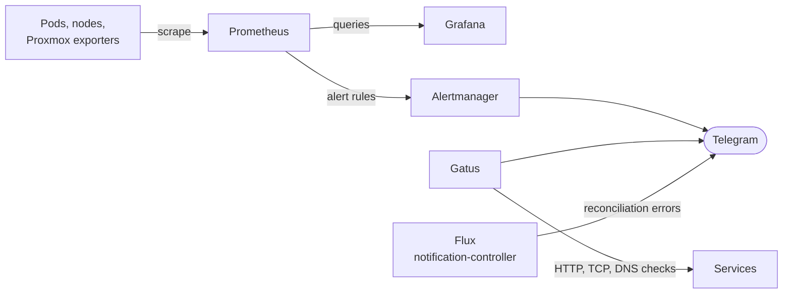

# Monitoring and alerting

Three independent sources send notifications to Telegram: Alertmanager for
metrics, Gatus for health checks and Flux for GitOps errors.

| Source | Fires on | Configured in |
|---|---|---|
| Alertmanager | Prometheus alert rules | `apps/prometheus/secret-alertmanager-config.sops.yaml` |
| Gatus | failing health checks | `apps/gatus/configmap-template.yaml` |
| Flux | `error` events of Flux objects | `infrastructure/notifications/` |

## Prometheus { #prometheus }

kube-prometheus-stack runs in the `prometheus` namespace; its UI is at
`prometheus.${DOMAIN}`, behind Authentik forward auth.

- **Retention**: 30 days or 18 GB, on a 20Gi `nfs-flash` volume.
- **Discovery**: ServiceMonitors, PodMonitors, PrometheusRules and Probes are
  picked up from every namespace, without a label selector.
- **Components**: Prometheus, Alertmanager, the Prometheus Operator,
  kube-state-metrics and node-exporter. The chart's Grafana is disabled:
  Grafana is [a separate app](#grafana).
- **Not scraped**: kube-proxy, kube-controller-manager, kube-scheduler and
  etcd. Talos does not expose their metrics by default, so their monitors are
  disabled to avoid permanent `TargetDown` alerts.
- **CRDs**: the release uses `crds: Skip`, so the Prometheus Operator CRDs in
  the cluster are older than the operator and are not upgraded with the
  chart.

| Job | Target | Defined by |
|---|---|---|
| `apiserver`, `kubelet`, `coredns`, `kube-state-metrics`, `node-exporter` | the cluster and its nodes | chart defaults, like the jobs of the stack itself |
| `proxmox-node-exporter` | node-exporter on the Proxmox host, port 9100 | Service and manual Endpoints in `apps/prometheus/` |
| `proxmox-zfs-exporter` | ZFS exporter on the Proxmox host, port 9134 | Service and manual Endpoints in `apps/prometheus/` |
| `cert-manager` | cert-manager controller | ServiceMonitor in `apps/prometheus/` |
| `gatus` | Gatus | ServiceMonitor in `apps/gatus/` |
| `authentik-server-metrics` | Authentik | Authentik chart |
| `server` | Immich server | Immich chart |
| `home-assistant` | Home Assistant `/api/prometheus` | Home Assistant chart; down, because the Prometheus integration is not enabled in Home Assistant |

## Alert rules { #alert-rules }

On top of the default rules of the chart, two PrometheusRules live in
`apps/prometheus/`:

| File | Group | Alerts |
|---|---|---|
| `prometheusrule-cluster.yaml` | `nodes` | `NodeNotReady`, `NodeMemoryHigh` (above 90%), `NodeFilesystemAlmostFull` (below 10% free), `NodeFilesystemCritical` (below 5% free), `NodeCpuSaturated`, `NodeClockSkew` |
| | `workload` | `PodCrashLooping`, `PodNotReady`, `DeploymentReplicasMismatch`, `StatefulSetReplicasMismatch` |
| | `certificates` | `CertManagerCertExpiringSoon` (less than 14 days), `CertManagerCertNotReady` |
| | `meta` | `ScrapeTargetDown`, `AlertmanagerConfigInconsistent` |
| `prometheusrule-zfs-storage.yaml` | `zfs.proxmox` | `ZfsExporterDown`, `ZfsPoolNotHealthy`, `ZfsPoolNearFull` (above 80%), `ZfsPoolCritical` (above 90%) |
| | `pvc.fill` | `PvcAlmostFull` (below 15% free), `PvcCritical`, `PvcInodesAlmostFull` |
| | `nfs.client` | `NfsTimeouts`, `NfsServerUnreachable` (no NFS traffic from any node) |

The summaries and descriptions of these rules are written in Italian.

## Alertmanager

- The whole configuration, routes and Telegram receiver included, is the
  `alertmanager.yaml` key of the SOPS Secret `alertmanager-config`; edit it
  with `sops`.
- Notification history is kept for 7 days on a 2Gi `nfs-flash` volume.
- `Watchdog`, the alert that always fires, is routed to the `null` receiver.
  The dead man's switch is prepared but not active: the steps to send it to
  an external heartbeat service are in the comments of
  `apps/prometheus/helm-release.yaml`. Until then, nothing notices when the
  whole cluster is down.

## Grafana { #grafana }

- `grafana.${DOMAIN}`, login with Authentik generic OAuth; Authentik groups
  map to Grafana roles (see [Applications](apps.md#grafana)).
- The Prometheus datasource is provisioned by the chart values.
- Admin credentials and the OAuth client are in two SOPS Secrets.
- Data, a SQLite database, on `grafana-storage` (`nfs-spacex`); like Gatus,
  the Deployment uses the `Recreate` strategy.
- The dashboards in `apps/grafana/grafana-dashboards/` (Kubernetes resources,
  node-exporter, ZFS) are ConfigMaps labelled `grafana_dashboard: "1"`, but the
  chart's dashboard sidecar is disabled, so Grafana does not load them.

## Gatus { #gatus }

- Status page at `gatus.${DOMAIN}`, login with Authentik OIDC.
- History in SQLite on `gatus-data` (`nfs-spacex`); the Deployment uses the
  `Recreate` strategy, so two pods never write the same database file.
- The OIDC and Telegram credentials come from the `gatus-secrets` Secret as
  environment variables; the configuration refers to them as `$${VAR}`.
- Telegram alerts after 3 failed checks in a row, and a resolved message
  after 4 good ones.

| Group | Checks |
|---|---|
| Public Services | Authentik, Gatus, Home Assistant, Immich and the Merlo Fiorillo shop through Traefik: status 200, response time, certificate valid for more than 14 days. The shop also accepts the 302 to the installer that an empty WordPress returns |
| Gateway | Traefik Service and MetalLB address: both must answer `301` (HTTP to HTTPS) |
| Auth | Authentik server, embedded outpost (`/outpost.goauthentik.io/ping`), PostgreSQL port |
| Home Automation | Home Assistant, Mosquitto, Zigbee2MQTT and a LED panel on the LAN |
| Immich | server, machine learning, PostgreSQL, Valkey |
| Merlo Fiorillo Shop | MariaDB port |
| Cluster Core | CoreDNS |
| Infrastructure | cert-manager and its webhook, MetalLB webhook, CloudNativePG webhook |
| External | Cloudflare DNS, GitHub, Docker Hub, without alerts |

Hosts without a route get a real 404 from the Traefik catch-all, so a check
that expects 200 fails when a route disappears.

## Flux notifications { #flux-notifications }

- The Alert `flux-failures` in `flux-system` forwards the `error` events of
  every GitRepository, Kustomization, HelmRepository and HelmRelease to the
  Provider `telegram`.
- `waiting.*retrying` and `Health check passed` messages are dropped.
- The Provider spec is SOPS-encrypted; the bot token reaches the Secret
  `telegram-bot` through the `${TELEGRAM_BOT_TOKEN}` substitution.

## Blind spots

- etcd, kube-scheduler and kube-controller-manager are not scraped: slow etcd
  disk writes and lost leader elections raise no alert.
- No metrics for Flux, Traefik, CloudNativePG or MetalLB.
- No external heartbeat: Alertmanager, Gatus and Flux all run inside the
  cluster they watch.
- The `home-assistant` target is down, so `TargetDown` fires permanently and
  adds noise.
