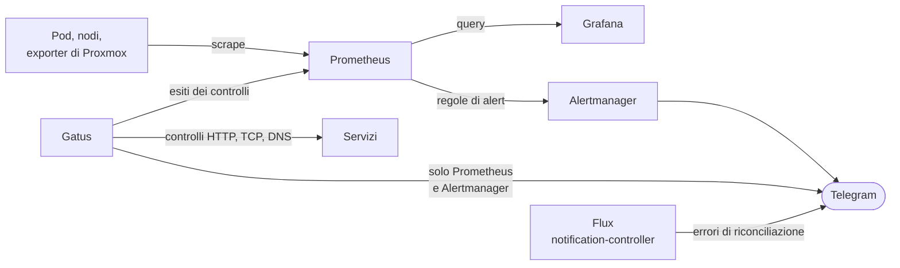

# Monitoraggio e alert

Su Telegram arrivano tre tipi di messaggi:

| Sorgente | Scatta su | Configurata in |
|---|---|---|
| Alertmanager | regole di alert di Prometheus, compresi i controlli di Gatus (`EndpointDown`) | routing in `apps/prometheus/helm-release.yaml`, regole in `apps/prometheus/prometheusrule-*.yaml` |
| Gatus | Prometheus o Alertmanager che non rispondono, il percorso da cui dipendono tutti gli altri alert | `apps/gatus/configmap-template.yaml` |
| Flux | eventi `error` degli oggetti Flux | `infrastructure/notifications/` |

## Prometheus { #prometheus }

kube-prometheus-stack gira nel namespace `prometheus`; la sua UI è su
`prometheus.${DOMAIN}`, dietro la forward auth di Authentik.

- **Retention**: 30 giorni o 18 GB, su un volume `nfs-flash` da 20Gi.
- **Discovery**: ServiceMonitor, PodMonitor, PrometheusRule e Probe vengono
  presi da ogni namespace, senza selettore di label.
- **Componenti**: Prometheus, Alertmanager, il Prometheus Operator,
  kube-state-metrics e node-exporter. Il Grafana del chart è disattivato:
  Grafana è [un'app separata](#grafana).
- **Non raccolti**: kube-proxy, kube-controller-manager, kube-scheduler ed
  etcd. Talos non espone le loro metriche di default, quindi i relativi
  monitor sono disattivati per evitare alert `TargetDown` permanenti.
- **CRD**: la release usa `crds: CreateReplace`, quindi le CRD del
  Prometheus Operator vengono aggiornate insieme al chart.

| Job | Target | Definito da |
|---|---|---|
| `apiserver`, `kubelet`, `coredns`, `kube-state-metrics`, `node-exporter` | il cluster e i suoi nodi | default del chart, come i job dello stack stesso |
| `proxmox-node-exporter` | node-exporter sull'host Proxmox, porta 9100 | Service ed Endpoints manuali in `apps/prometheus/` |
| `proxmox-zfs-exporter` | exporter ZFS sull'host Proxmox, porta 9134 | Service ed Endpoints manuali in `apps/prometheus/` |
| `cert-manager` | controller di cert-manager | ServiceMonitor in `apps/prometheus/` |
| `gatus` | Gatus | ServiceMonitor in `apps/gatus/` |
| `authentik-server-metrics` | Authentik | chart di Authentik |
| `server` | server di Immich | chart di Immich |
| `home-assistant` | `/api/prometheus` di Home Assistant | chart di Home Assistant; spento, perché in Home Assistant l'integrazione Prometheus non è attiva (`/api/prometheus` risponde 404) |

## Regole di alert { #alert-rules }

### Criticità

Ogni alert ha una di quattro severity, che decidono se e come arriva su
Telegram:

| Severity | Significato | Telegram |
|---|---|---|
| `critical` | utenti o dati colpiti adesso: un nodo, il percorso di ingresso, Home Assistant, Authentik, Immich, il negozio, un pool ZFS | con suono, a qualsiasi ora; ripetuto ogni 4 ore |
| `warning` | degrado da sistemare entro un giorno: crash loop, job falliti, OOM kill, certificati in scadenza, controlli interni | silenzioso, solo 07:00-22:00 UTC (08:00-23:00 in Italia d'inverno); un warning nato di notte arriva al mattino se è ancora attivo; ripetuto ogni 24 ore |
| `info` | contesto: uso della CPU, throttling, burn degli SLO dell'API server, overcommit | nessuna notifica, solo nella UI di Alertmanager |
| `none` | `Watchdog`, `InfoInhibitor`, `RolloutInProgress` | nessuna notifica |

### Regole

La base sono le regole di default del chart; `defaultRules` e `customRules`
in `apps/prometheus/helm-release.yaml` le modificano:

| Regola di default | Modifica | Perché |
|---|---|---|
| `KubeNodeNotReady` | `critical`, 5 minuti | un nodo giù si porta dietro i suoi pod; i nodi in cordon (drain, upgrade di Talos) sono ignorati |
| `KubeNodePressure` | `warning` (era `info`) | il kubelet sta espellendo pod |
| `KubeAPIErrorBudgetBurn` | `info` | scattava per giorni a causa della latenza nota di etcd |
| `KubeCPUOvercommit`, `KubeMemoryOvercommit` | `info` | pianificazione della capacità |
| `NodeFilesystemAlmostOutOfSpace`, `NodeClockSkewDetected` | disattivate | le regole custom qui sotto coprono anche l'host Proxmox |
| `KubePersistentVolumeFillingUp`, `KubePersistentVolumeInodesFillingUp` | disattivate | ogni PVC sta su NFS e riporta lo spazio libero dell'intero dataset: un pool pieno scattava una volta per PVC |

Le PrometheusRule custom in `apps/prometheus/` coprono quello che manca ai
default:

| File | Alert |
|---|---|
| `prometheusrule-cluster.yaml` | `NodeMemoryPressure` (pressure stall information, così l'host Proxmox, al 90% di memoria per scelta, non scatta), `NodeFilesystemAlmostFull` (`warning` sotto il 10% libero, `critical` sotto il 5%), `NodeClockSkew`, `ContainerOOMKilled`, `CertManagerCertExpiringSoon` (`warning` sotto i 14 giorni, `critical` sotto i 7), `CertManagerCertNotReady`, `AlertSourceDown` (kube-state-metrics o Gatus giù: gli alert basati su di loro non possono scattare) |
| `prometheusrule-zfs-storage.yaml` | `ZfsPoolNotHealthy`, `ZfsPoolAlmostFull` (`warning` oltre l'80%, `critical` oltre il 90%), `NfsTimeouts`, `NfsServerUnreachable` |
| `prometheusrule-endpoints.yaml` | `EndpointDown`: un controllo di Gatus che fallisce da 5 minuti, con la severity e il namespace impostati sull'endpoint (vedi [Gatus](#gatus)) |
| `prometheusrule-rollouts.yaml` | `RolloutInProgress`: la finestra di update, vedi sotto |

### Finestra di update { #update-window }

Un update, da una pull request di Renovate o manuale, riavvia dei pod: per
qualche minuto i controlli di salute falliscono, i pod non sono pronti e i
target spariscono. `RolloutInProgress` scatta per un namespace finché:

- un Deployment, uno StatefulSet o un DaemonSet del namespace ha cambiato
  generation negli ultimi 15 minuti;
- un pod non creato da un Job è nato negli ultimi 15 minuti (CloudNativePG
  sostituisce i suoi pod senza StatefulSet);
- un Deployment o uno StatefulSet che ha cambiato generation negli ultimi 30
  minuti non è ancora del tutto disponibile (pull lenti delle immagini).

Finché scatta, Alertmanager inibisce gli alert di disponibilità di quel
namespace (`EndpointDown`, `TargetDown`, `KubePodNotReady`,
`KubePodCrashLooping`, `KubeContainerWaiting`, i mismatch di repliche e di
generation); durante un update di `traefik`, `metallb` o `kube-system` è
inibito ogni `EndpointDown`. Se l'update lascia qualcosa di rotto, l'alert
parte appena la finestra si chiude. Mai inibiti, perché sono il modo in cui
si vede un update fallito: `KubeDeploymentRolloutStuck`,
`KubeStatefulSetUpdateNotRolledOut`, `KubeDaemonSetRolloutStuck`,
`KubeJobFailed`, `ContainerOOMKilled` e gli errori di Flux.

Nei 30 giorni prima della modifica, ogni interruzione di Gatus di 5 minuti o
più cadeva dentro una finestra di update, a parte un controllo con una
condizione sbagliata, poi corretta.

## Alertmanager

- Routing, receiver e template del messaggio sono in chiaro nei values di
  `apps/prometheus/helm-release.yaml` (`alertmanager.config` e
  `alertmanager.templateFiles`). Solo il token del bot e il chat id sono
  segreti: `apps/prometheus/secret-alertmanager-telegram.sops.yaml`, montato
  in `/etc/alertmanager/secrets/alertmanager-telegram/` e letto con
  `bot_token_file` e `chat_id_file`. Alertmanager usa un bot suo, non quello
  di Flux e Gatus.
- Gli alert sono raggruppati per nome e namespace; `EndpointDown` solo per
  nome, così un guasto dell'ingresso è un solo messaggio.
- Un alert critical inibisce il warning dello stesso alert sullo stesso
  oggetto.
- Per silenziare qualcosa a mano, per esempio durante una manutenzione su
  Proxmox, si crea un silence nella UI di Alertmanager
  (`kubectl -n prometheus port-forward svc/kube-prometheus-stack-alertmanager 9093`).
- Lo storico delle notifiche resta per 7 giorni su un volume `nfs-flash` da
  2Gi.
- `Watchdog`, l'alert che scatta sempre, è instradato al receiver `null`. Il
  dead man's switch è predisposto ma non attivo: i passi per mandarlo a un
  servizio di heartbeat esterno sono nei commenti di
  `apps/prometheus/helm-release.yaml`. Fino ad allora, nessuno si accorge se
  si ferma l'intero cluster.

## Grafana { #grafana }

- `grafana.${DOMAIN}`, login con il generic OAuth di Authentik; i gruppi di
  Authentik corrispondono ai ruoli di Grafana (vedi
  [Applicazioni](apps.md#grafana)).
- Il datasource Prometheus è creato dai values del chart.
- Le credenziali di admin e il client OAuth stanno in due Secret SOPS.
- I dati, un database SQLite, stanno su `grafana-storage` (`nfs-spacex`); come
  per Gatus, il Deployment usa la strategia `Recreate`.
- Le dashboard in `apps/grafana/grafana-dashboards/` (risorse Kubernetes,
  node-exporter, ZFS) sono ConfigMap con la label `grafana_dashboard: "1"`, ma
  il sidecar delle dashboard del chart è disattivato, quindi Grafana non le
  carica.

## Gatus { #gatus }

- Pagina di stato su `gatus.${DOMAIN}`, login con OIDC di Authentik.
- Storico in SQLite su `gatus-data` (`nfs-spacex`); il Deployment usa la
  strategia `Recreate`, così due pod non scrivono mai lo stesso file di
  database.
- Le credenziali OIDC e Telegram arrivano dal Secret `gatus-secrets` come
  variabili d'ambiente; la configurazione vi fa riferimento come `$${VAR}`.
- Gatus notifica Telegram direttamente solo per Prometheus e Alertmanager
  (gruppo `Alerting`, dopo 3 controlli falliti di fila). Ogni altro endpoint
  ha due `extra-labels` che Gatus aggiunge alle sue metriche: `severity`
  (`critical`, `warning` oppure `info`, che non viene mai notificato) e
  `target_namespace`. `EndpointDown` trasforma un controllo che fallisce da 5
  minuti in un alert di Alertmanager in quel namespace, che quindi segue il
  routing per severity e la [finestra di update](#update-window).

| Gruppo | Controlli | Severity |
|---|---|---|
| Public Services | Authentik, Gatus, Home Assistant, Immich e il negozio Merlo Fiorillo passando da Traefik: stato 200, tempo di risposta, certificato valido per più di 14 giorni. Per il negozio va bene anche il 302 verso l'installer che restituisce un WordPress vuoto | `critical`; Gatus `warning` |
| Gateway | Service di Traefik e indirizzo MetalLB: entrambi devono rispondere `301` (da HTTP a HTTPS) | `critical` |
| Auth | server di Authentik, outpost integrato (`/outpost.goauthentik.io/ping`), porta di PostgreSQL | `critical`; outpost `warning` |
| Home Automation | Home Assistant, Mosquitto, Zigbee2MQTT e un pannello LED in LAN | `critical`; pannello LED `info` |
| Immich | server, machine learning, PostgreSQL, Valkey | `critical`; machine learning `warning` (si fermano ricerca e volti, foto e upload funzionano) |
| Merlo Fiorillo Shop | porta di MariaDB | `critical` |
| Cluster Core | CoreDNS | `critical` |
| Infrastructure | cert-manager e il suo webhook, webhook di MetalLB, webhook di CloudNativePG | `warning` |
| Alerting | `/-/healthy` di Prometheus e Alertmanager | alert Telegram diretto |
| External | DNS di Cloudflare, GitHub, Docker Hub | `info` |

Gli host senza route ricevono un 404 vero dalla catch-all di Traefik, quindi
un controllo che si aspetta 200 fallisce quando una route sparisce.

## Notifiche di Flux { #flux-notifications }

- L'Alert `flux-failures` in `flux-system` inoltra al Provider `telegram` gli
  eventi `error` di ogni GitRepository, OCIRepository, HelmRepository,
  HelmChart e Kustomization, e delle HelmRelease.
- Una event source senza namespace vale solo per `flux-system`, e il
  namespace non accetta wildcard: l'Alert elenca il namespace di ogni
  HelmRelease. **Una nuova app con una HelmRelease deve aggiungere lì il suo
  namespace**, altrimenti i suoi upgrade falliti non arrivano mai su Telegram
  (fino a questa modifica non ne arrivava nessuno).
- I messaggi `waiting.*retrying` e `Health check passed` vengono scartati.
- Lo spec del Provider è cifrato con SOPS; il token del bot arriva al Secret
  `telegram-bot` tramite la sostituzione di `${TELEGRAM_BOT_TOKEN}`.

## Punti ciechi

- etcd, kube-scheduler e kube-controller-manager non vengono raccolti: le
  scritture lente sul disco di etcd e le leader election perse non generano
  alert.
- Nessuna metrica per Flux, Traefik, CloudNativePG o MetalLB.
- Nessun heartbeat esterno: Alertmanager, Gatus e Flux girano tutti dentro il
  cluster che sorvegliano. Gatus si accorge se si fermano Prometheus o
  Alertmanager, non se si ferma l'intero cluster o l'host Proxmox.
- Nessun alert sui cluster CloudNativePG e sui loro backup.
