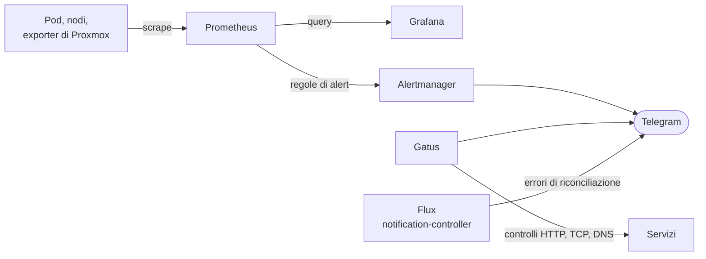

# Monitoraggio e alert

Tre sorgenti indipendenti mandano notifiche su Telegram: Alertmanager per le
metriche, Gatus per i controlli di salute e Flux per gli errori GitOps.

| Sorgente | Scatta su | Configurata in |
|---|---|---|
| Alertmanager | regole di alert di Prometheus | `apps/prometheus/secret-alertmanager-config.sops.yaml` |
| Gatus | controlli di salute falliti | `apps/gatus/configmap-template.yaml` |
| Flux | eventi `error` degli oggetti Flux | `infrastructure/notifications/` |

## Prometheus { #prometheus }

kube-prometheus-stack gira nel namespace `prometheus`; la sua UI è su
`prometheus.${DOMAIN}`, dietro la forward auth di Authentik.

- **Retention**: 30 giorni o 18 GB, su un volume `nfs-flash` da 20Gi.
- **Discovery**: ServiceMonitor, PodMonitor, PrometheusRule e Probe vengono
  presi da ogni namespace, senza selettore di label.
- **Componenti**: Prometheus, Alertmanager, il Prometheus Operator,
  kube-state-metrics e node-exporter. Il Grafana del chart è disattivato:
  Grafana è [un'app separata](#grafana).
- **Non raccolti**: kube-proxy, kube-controller-manager, kube-scheduler ed
  etcd. Talos non espone le loro metriche di default, quindi i relativi
  monitor sono disattivati per evitare alert `TargetDown` permanenti.
- **CRD**: la release usa `crds: Skip`, quindi le CRD del Prometheus Operator
  nel cluster sono più vecchie dell'operatore e non vengono aggiornate con il
  chart.

| Job | Target | Definito da |
|---|---|---|
| `apiserver`, `kubelet`, `coredns`, `kube-state-metrics`, `node-exporter` | il cluster e i suoi nodi | default del chart, come i job dello stack stesso |
| `proxmox-node-exporter` | node-exporter sull'host Proxmox, porta 9100 | Service ed Endpoints manuali in `apps/prometheus/` |
| `proxmox-zfs-exporter` | exporter ZFS sull'host Proxmox, porta 9134 | Service ed Endpoints manuali in `apps/prometheus/` |
| `cert-manager` | controller di cert-manager | ServiceMonitor in `apps/prometheus/` |
| `gatus` | Gatus | ServiceMonitor in `apps/gatus/` |
| `authentik-server-metrics` | Authentik | chart di Authentik |
| `server` | server di Immich | chart di Immich |
| `home-assistant` | `/api/prometheus` di Home Assistant | chart di Home Assistant; down, perché in Home Assistant l'integrazione Prometheus non è attiva |

## Regole di alert { #alert-rules }

Oltre alle regole di default del chart, in `apps/prometheus/` ci sono due
PrometheusRule:

| File | Gruppo | Alert |
|---|---|---|
| `prometheusrule-cluster.yaml` | `nodes` | `NodeNotReady`, `NodeMemoryHigh` (oltre il 90%), `NodeFilesystemAlmostFull` (meno del 10% libero), `NodeFilesystemCritical` (meno del 5% libero), `NodeCpuSaturated`, `NodeClockSkew` |
| | `workload` | `PodCrashLooping`, `PodNotReady`, `DeploymentReplicasMismatch`, `StatefulSetReplicasMismatch` |
| | `certificates` | `CertManagerCertExpiringSoon` (meno di 14 giorni), `CertManagerCertNotReady` |
| | `meta` | `ScrapeTargetDown`, `AlertmanagerConfigInconsistent` |
| `prometheusrule-zfs-storage.yaml` | `zfs.proxmox` | `ZfsExporterDown`, `ZfsPoolNotHealthy`, `ZfsPoolNearFull` (oltre l'80%), `ZfsPoolCritical` (oltre il 90%) |
| | `pvc.fill` | `PvcAlmostFull` (meno del 15% libero), `PvcCritical`, `PvcInodesAlmostFull` |
| | `nfs.client` | `NfsTimeouts`, `NfsServerUnreachable` (nessun traffico NFS da nessun nodo) |

I summary e le description di queste regole sono scritti in italiano.

## Alertmanager

- Tutta la configurazione, route e receiver Telegram compresi, è la chiave
  `alertmanager.yaml` del Secret SOPS `alertmanager-config`; si modifica con
  `sops`.
- Lo storico delle notifiche resta per 7 giorni su un volume `nfs-flash` da
  2Gi.
- `Watchdog`, l'alert che scatta sempre, è instradato al receiver `null`. Il
  dead man's switch è predisposto ma non attivo: i passi per mandarlo a un
  servizio di heartbeat esterno sono nei commenti di
  `apps/prometheus/helm-release.yaml`. Fino ad allora, nessuno si accorge se
  si ferma l'intero cluster.

## Grafana { #grafana }

- `grafana.${DOMAIN}`, login con il generic OAuth di Authentik; i gruppi di
  Authentik corrispondono ai ruoli di Grafana (vedi
  [Applicazioni](apps.md#grafana)).
- Il datasource Prometheus è creato dai values del chart.
- Le credenziali di admin e il client OAuth stanno in due Secret SOPS.
- I dati, un database SQLite, stanno su `grafana-storage` (`nfs-spacex`); come
  per Gatus, il Deployment usa la strategia `Recreate`.
- Le dashboard in `apps/grafana/grafana-dashboards/` (risorse Kubernetes,
  node-exporter, ZFS) sono ConfigMap con la label `grafana_dashboard: "1"`, ma
  il sidecar delle dashboard del chart è disattivato, quindi Grafana non le
  carica.

## Gatus { #gatus }

- Pagina di stato su `gatus.${DOMAIN}`, login con OIDC di Authentik.
- Storico in SQLite su `gatus-data` (`nfs-spacex`); il Deployment usa la
  strategia `Recreate`, così due pod non scrivono mai lo stesso file di
  database.
- Le credenziali OIDC e Telegram arrivano dal Secret `gatus-secrets` come
  variabili d'ambiente; la configurazione vi fa riferimento come `$${VAR}`.
- L'alert su Telegram parte dopo 3 controlli falliti di fila, e il messaggio
  di risoluzione dopo 4 controlli riusciti.

| Gruppo | Controlli |
|---|---|
| Public Services | Authentik, Gatus, Home Assistant, Immich e il negozio Merlo Fiorillo passando da Traefik: stato 200, tempo di risposta, certificato valido per più di 14 giorni. Per il negozio va bene anche il 302 verso l'installer che restituisce un WordPress vuoto |
| Gateway | Service di Traefik e indirizzo MetalLB: entrambi devono rispondere `301` (da HTTP a HTTPS) |
| Auth | server di Authentik, outpost integrato (`/outpost.goauthentik.io/ping`), porta di PostgreSQL |
| Home Automation | Home Assistant, Mosquitto, Zigbee2MQTT e un pannello LED in LAN |
| Immich | server, machine learning, PostgreSQL, Valkey |
| Merlo Fiorillo Shop | porta di MariaDB |
| Cluster Core | CoreDNS |
| Infrastructure | cert-manager e il suo webhook, webhook di MetalLB, webhook di CloudNativePG |
| External | DNS di Cloudflare, GitHub, Docker Hub, senza alert |

Gli host senza route ricevono un 404 vero dalla catch-all di Traefik, quindi
un controllo che si aspetta 200 fallisce quando una route sparisce.

## Notifiche di Flux { #flux-notifications }

- L'Alert `flux-failures` in `flux-system` inoltra al Provider `telegram` gli
  eventi `error` di ogni GitRepository, Kustomization, HelmRepository e
  HelmRelease.
- I messaggi `waiting.*retrying` e `Health check passed` vengono scartati.
- Lo spec del Provider è cifrato con SOPS; il token del bot arriva al Secret
  `telegram-bot` tramite la sostituzione di `${TELEGRAM_BOT_TOKEN}`.

## Punti ciechi

- etcd, kube-scheduler e kube-controller-manager non vengono raccolti: le
  scritture lente sul disco di etcd e le leader election perse non generano
  alert.
- Nessuna metrica per Flux, Traefik, CloudNativePG o MetalLB.
- Nessun heartbeat esterno: Alertmanager, Gatus e Flux girano tutti dentro il
  cluster che sorvegliano.
- Il target `home-assistant` è down, quindi `TargetDown` scatta in permanenza
  e aggiunge rumore.
