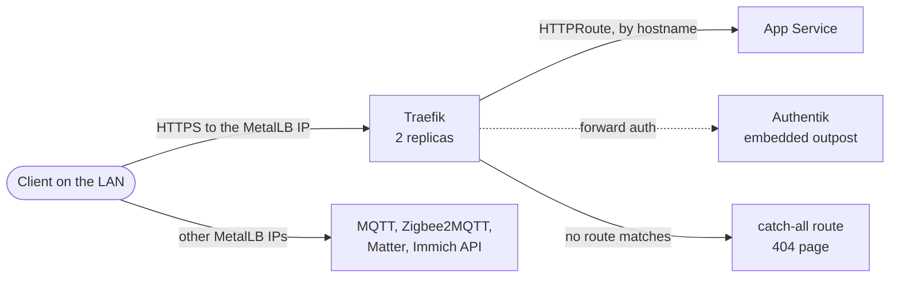
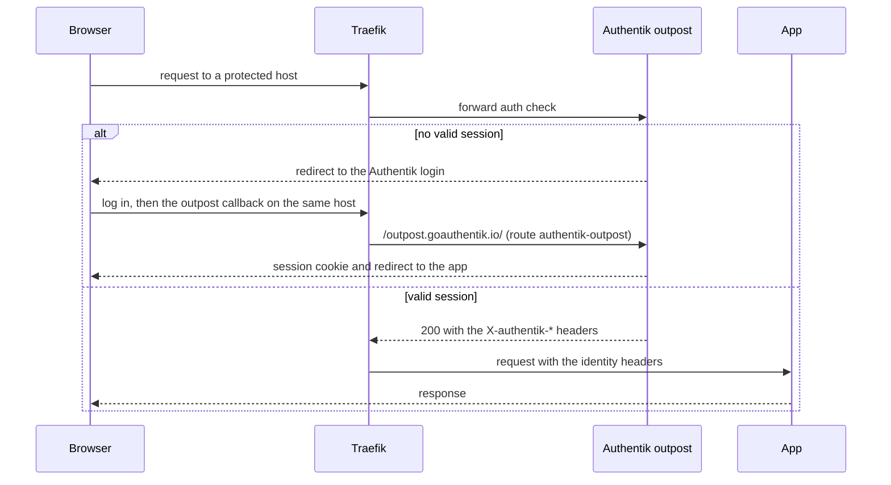

# Networking

## Request path



Web traffic enters through Traefik on one MetalLB address. A few services
have their own MetalLB address and are reached directly, without Traefik and
without Authentik.

## LAN addresses { #lan-addresses }

The cluster sits on the home network `192.168.178.0/24`, next to the router
(`.1`, also the upstream DNS server) and the Proxmox host (`.162`, NFS server
and exporters). MetalLB hands out `192.168.178.10`–`192.168.178.40` in layer 2
mode; every Service asks for a fixed address with the
`metallb.io/loadBalancerIPs` annotation.

| Address | Service | Ports | Notes |
|---|---|---|---|
| `192.168.178.10` | `traefik/traefik` | 80, 443 | all web traffic |
| `192.168.178.11` | `zigbee2mqtt/zigbee2mqtt` | 8080 | Zigbee2MQTT frontend, no authentication |
| `192.168.178.12` | `home-assistant/home-assistant`, `mqtt/mosquitto` | 8080, 1883 | one address shared by two Services (`metallb.io/allow-shared-ip`) |
| `192.168.178.14` | `home-assistant-matter-server/home-assistant-matter-server` | 5580 | Matter Server WebSocket API, no authentication |
| `192.168.178.15` | `immich/immich-server` | 2283, 8081, 8082 | Immich API and its metrics ports |

Home Assistant and the Matter Server also use host networking, for device
discovery, so they answer on the IP of the node they run on as well (ports
8123 and 5580).

## Traefik and the Gateway API { #traefik-and-the-gateway-api }

### Gateway

One Gateway, `traefik/traefik-gateway` (class `traefik`), defined in
`infrastructure/traefik/gateway.yaml`, accepts routes from every namespace:

| Listener | Port in the pod | Port on the LAN | Protocol | TLS |
|---|---|---|---|---|
| `web` | 8000 | 80 | HTTP | – (redirected to HTTPS) |
| `websecure` | 8443 | 443 | HTTPS | Secret `wildcard-apps-tls` |

!!! note "Two definitions of the same Gateway"
    The Traefik chart renders a Gateway with the same name, with only the
    `web` listener, because its `gateway` values are left at their defaults.
    The object is therefore written by both Helm and Flux; Flux reapplies
    `gateway.yaml`, with both listeners, at every reconciliation.

### Entry points

- `web` redirects every request to `websecure` with HTTPS.
- `websecure` terminates TLS with the wildcard certificate, also set as the
  default certificate of the Traefik TLS store, and allows 600 seconds for
  reads, writes and idle connections, so that large uploads do not time out.
- `websecure` runs the `traefik-errors` middleware on every response: a 404,
  500 or 503 gets the matching page from the `traefik-error-pages` nginx
  Deployment (HTML files in `infrastructure/traefik/error-pages/`). This also
  replaces the JSON error bodies of APIs.
- The `catch-all` HTTPRoute takes the requests that match no other route and
  answers with a real 404, so a monitor notices when a route disappears.

### Routes

Every app publishes itself with an HTTPRoute attached to the `websecure`
listener:

```yaml
apiVersion: gateway.networking.k8s.io/v1
kind: HTTPRoute
metadata:
  name: example
  namespace: example
spec:
  parentRefs:
    - name: traefik-gateway
      namespace: traefik
      sectionName: websecure
  hostnames:
    - "example.${DOMAIN}"
  rules:
    - matches:
        - path:
            type: PathPrefix
            value: /
      # Only for apps without their own login, see below.
      filters:
        - type: ExtensionRef
          extensionRef:
            group: traefik.io
            kind: Middleware
            name: authentik-forward-auth
      backendRefs:
        - name: example
          port: 8080
```

| Hostname | Route | Access |
|---|---|---|
| `auth.${DOMAIN}` | created by the Authentik chart | Authentik login |
| `home.${DOMAIN}` | `home-assistant/home-assistant` | Home Assistant login |
| `code-home.${DOMAIN}` | `home-assistant/home-assistant-codeserver` | forward auth |
| `immich.${DOMAIN}` | `immich/immich` | Immich login |
| `gatus.${DOMAIN}` | `gatus/gatus` | OIDC |
| `grafana.${DOMAIN}` | `grafana/grafana` | OIDC |
| `prometheus.${DOMAIN}` | `prometheus/prometheus` | forward auth |
| `traefik.${DOMAIN}` | IngressRoute of the Traefik chart | forward auth |
| `trek.${DOMAIN}` | `trek/trek` | OIDC |
| `social-media-reuploader.${DOMAIN}` | `social-media-reuploader/social-media-reuploader-gui` | OAuth |
| `soulsync.${DOMAIN}` | `media/soulsync` | forward auth |
| `slskd.${DOMAIN}` | `media/slskd` | forward auth |
| `prowlarr.${DOMAIN}` | `media/prowlarr` | forward auth |
| `transmission.${DOMAIN}` | `media/transmission` | forward auth |
| `homelab.${DOMAIN}` | `external-services/external-http` | forward auth |
| `immich`, `immich.lan` | `immich/immich-internal`, on `web` and `websecure` | Immich login |

The wildcard certificate covers `*.${DOMAIN}` and `*.home.${DOMAIN}` only:
other names, such as `immich.lan`, get a certificate that does not match them.

## Forward authentication { #forward-auth }

Apps without their own login are protected by the Traefik middleware
`authentik-forward-auth`, which asks the Authentik embedded outpost
(`ak-outpost-authentik-embedded-outpost.authentik:9000`) about every request:



- An HTTPRoute can only use a Middleware of its own namespace, so the
  middleware is copied where it is needed: `traefik` (dashboard),
  `home-assistant`, `prometheus`, `external-services` and `media`.
- The HTTPRoute `authentik/authentik-outpost` sends `/outpost.goauthentik.io`
  on every host under `${DOMAIN}` to the outpost, which completes the login.
- The middleware forwards the `X-authentik-*` headers (user name, groups,
  e-mail, JWT) to the app.

## DNS { #dns }

**Inside the cluster**, CoreDNS runs as installed by Talos, but its Corefile
comes from `infrastructure/kube-system/coredns-config.yaml`:

- `cluster.local` and the reverse zones are answered by the `kubernetes`
  plugin;
- every other name is forwarded to the router, `1.1.1.1` and `8.8.8.8` in
  round robin, with a 300 second cache;
- the `lan` zone goes to the router only, so that names like `immich.lan`
  resolve.

Talos writes its own Corefile again during a Kubernetes upgrade
(`talosctl upgrade-k8s`); Flux puts this one back at its next reconciliation.

**Public DNS** is hosted on Cloudflare. cert-manager creates the DNS-01
challenge records with an API token; the other records, and any port
forwarding on the router, are managed outside this repository.

## Pod network

flannel, the Talos default, provides the pod network. flannel does not enforce
NetworkPolicies: every pod can reach every other pod and Service. See
[Security and secrets](security.md#network).
