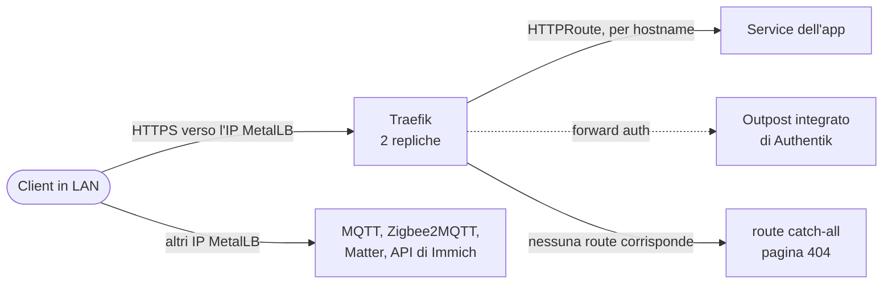
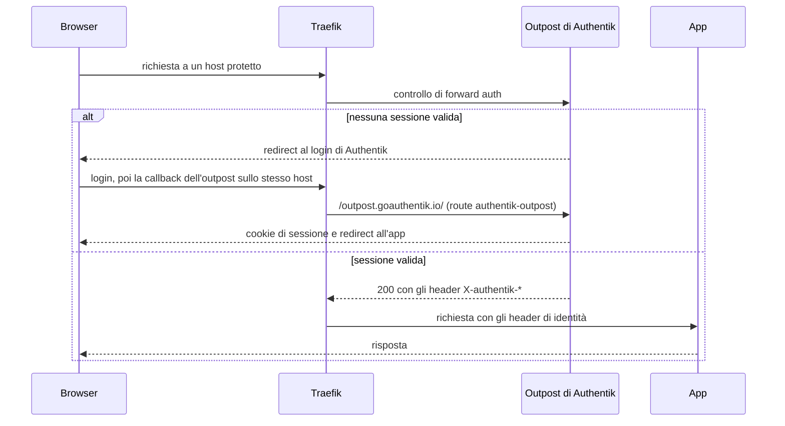

# Rete

## Percorso di una richiesta



Il traffico web entra da Traefik su un indirizzo MetalLB. Alcuni servizi
hanno un proprio indirizzo MetalLB e si raggiungono direttamente, senza
Traefik e senza Authentik.

## Indirizzi in LAN { #lan-addresses }

Il cluster sta sulla rete di casa `192.168.178.0/24`, insieme al router
(`.1`, che è anche il DNS a monte) e all'host Proxmox (`.162`, server NFS ed
exporter). MetalLB assegna `192.168.178.10`–`192.168.178.40` in modalità
layer 2; ogni Service chiede un indirizzo fisso con l'annotazione
`metallb.io/loadBalancerIPs`.

| Indirizzo | Service | Porte | Note |
|---|---|---|---|
| `192.168.178.10` | `traefik/traefik` | 80, 443 | tutto il traffico web |
| `192.168.178.11` | `zigbee2mqtt/zigbee2mqtt` | 8080 | frontend di Zigbee2MQTT, senza autenticazione |
| `192.168.178.12` | `home-assistant/home-assistant`, `mqtt/mosquitto` | 8080, 1883 | un indirizzo condiviso da due Service (`metallb.io/allow-shared-ip`) |
| `192.168.178.14` | `home-assistant-matter-server/home-assistant-matter-server` | 5580 | API WebSocket del Matter Server, senza autenticazione |
| `192.168.178.15` | `immich/immich-server` | 2283, 8081, 8082 | API di Immich e le sue porte delle metriche |

Home Assistant e il Matter Server usano anche la rete dell'host, per il
discovery dei dispositivi, quindi rispondono anche sull'IP del nodo su cui
girano (porte 8123 e 5580).

## Traefik e la Gateway API { #traefik-and-the-gateway-api }

### Gateway

Un solo Gateway, `traefik/traefik-gateway` (classe `traefik`), definito in
`infrastructure/traefik/gateway.yaml`, accetta route da ogni namespace:

| Listener | Porta nel pod | Porta in LAN | Protocollo | TLS |
|---|---|---|---|---|
| `web` | 8000 | 80 | HTTP | – (reindirizzato su HTTPS) |
| `websecure` | 8443 | 443 | HTTPS | Secret `wildcard-apps-tls` |

!!! note "Due definizioni dello stesso Gateway"
    Anche il chart di Traefik genera un Gateway con lo stesso nome, con il
    solo listener `web`, perché i suoi values `gateway` sono lasciati ai
    default. L'oggetto quindi viene scritto sia da Helm sia da Flux; Flux
    riapplica `gateway.yaml`, con entrambi i listener, a ogni riconciliazione.

### Entry point

- `web` reindirizza ogni richiesta su `websecure` in HTTPS.
- `websecure` termina il TLS con il certificato wildcard, impostato anche come
  certificato di default del TLS store di Traefik, e concede 600 secondi a
  letture, scritture e connessioni inattive, così gli upload grandi non vanno
  in timeout.
- `websecure` applica a ogni risposta il middleware `traefik-errors`: un 404,
  500 o 503 riceve la pagina corrispondente dal Deployment nginx
  `traefik-error-pages` (file HTML in `infrastructure/traefik/error-pages/`).
  Questo sostituisce anche i corpi JSON degli errori delle API.
- La HTTPRoute `catch-all` prende le richieste che non corrispondono a
  nessun'altra route e risponde con un 404 vero, così un monitor si accorge
  quando una route sparisce.

### Route

Ogni app si pubblica con una HTTPRoute agganciata al listener `websecure`:

```yaml
apiVersion: gateway.networking.k8s.io/v1
kind: HTTPRoute
metadata:
  name: example
  namespace: example
spec:
  parentRefs:
    - name: traefik-gateway
      namespace: traefik
      sectionName: websecure
  hostnames:
    - "example.${DOMAIN}"
  rules:
    - matches:
        - path:
            type: PathPrefix
            value: /
      # Solo per le app senza un login proprio, vedi sotto.
      filters:
        - type: ExtensionRef
          extensionRef:
            group: traefik.io
            kind: Middleware
            name: authentik-forward-auth
      backendRefs:
        - name: example
          port: 8080
```

| Hostname | Route | Accesso |
|---|---|---|
| `auth.${DOMAIN}` | creata dal chart di Authentik | login di Authentik |
| `home.${DOMAIN}` | `home-assistant/home-assistant` | login di Home Assistant |
| `code-home.${DOMAIN}` | `home-assistant/home-assistant-codeserver` | forward auth |
| `immich.${DOMAIN}` | `immich/immich` | login di Immich |
| `gatus.${DOMAIN}` | `gatus/gatus` | OIDC |
| `grafana.${DOMAIN}` | `grafana/grafana` | OIDC |
| `prometheus.${DOMAIN}` | `prometheus/prometheus` | forward auth |
| `traefik.${DOMAIN}` | IngressRoute del chart di Traefik | forward auth |
| `trek.${DOMAIN}` | `trek/trek` | OIDC |
| `social-media-reuploader.${DOMAIN}` | `social-media-reuploader/social-media-reuploader-gui` | OAuth |
| `homelab.${DOMAIN}` | `external-services/external-http` | forward auth |
| `immich`, `immich.lan` | `immich/immich-internal`, su `web` e `websecure` | login di Immich |

Il certificato wildcard copre solo `*.${DOMAIN}` e `*.home.${DOMAIN}`: gli
altri nomi, come `immich.lan`, ricevono un certificato che non corrisponde.

## Forward authentication { #forward-auth }

Le app senza un login proprio sono protette dal middleware Traefik
`authentik-forward-auth`, che interroga l'outpost integrato di Authentik
(`ak-outpost-authentik-embedded-outpost.authentik:9000`) a ogni richiesta:



- Una HTTPRoute può usare solo un Middleware del proprio namespace, quindi il
  middleware è copiato dove serve: `traefik` (dashboard), `home-assistant`,
  `prometheus` e `external-services`.
- La HTTPRoute `authentik/authentik-outpost` manda all'outpost il path
  `/outpost.goauthentik.io` di ogni host sotto `${DOMAIN}`, e l'outpost
  completa il login.
- Il middleware passa all'app gli header `X-authentik-*` (nome utente,
  gruppi, e-mail, JWT).

## DNS { #dns }

**Dentro il cluster**, CoreDNS gira come lo installa Talos, ma il suo
Corefile arriva da `infrastructure/kube-system/coredns-config.yaml`:

- a `cluster.local` e alle zone inverse risponde il plugin `kubernetes`;
- ogni altro nome viene inoltrato al router, a `1.1.1.1` e a `8.8.8.8` in
  round robin, con una cache di 300 secondi;
- la zona `lan` va solo al router, così si risolvono nomi come `immich.lan`.

Talos riscrive il proprio Corefile durante un upgrade di Kubernetes
(`talosctl upgrade-k8s`); Flux rimette questo alla riconciliazione
successiva.

**Il DNS pubblico** è su Cloudflare. cert-manager crea i record delle
challenge DNS-01 con un token API; gli altri record, e l'eventuale port
forwarding sul router, sono gestiti fuori da questo repository.

## Rete dei pod

La rete dei pod è fornita da flannel, il default di Talos. flannel non applica
le NetworkPolicy: ogni pod raggiunge ogni altro pod e Service. Vedi
[Sicurezza e segreti](security.md#network).
