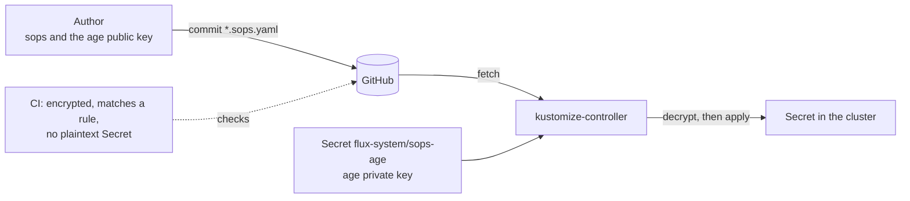

# Security and secrets

## SOPS and age { #sops-and-age }



Every Secret in the repository is a SOPS file named `*.sops.yaml`, encrypted
for a single age recipient. The three Flux Kustomizations decrypt them with
the private key in the Secret `flux-system/sops-age`, which was created
outside Git when the cluster was bootstrapped.

`.sops.yaml` picks the fields to encrypt from the path of the file:

| Path | Encrypted fields |
|---|---|
| `infrastructure/**/secret-*.sops.yaml` | `data`, `stringData` |
| `infrastructure/notifications/provider-telegram.sops.yaml` | the whole `spec` |
| `apps/**/secret-*.sops.yaml` | `data`, `stringData` |

Everything else in a file, such as `metadata` and the key names, stays
readable, which is what CI relies on.

```bash
# sops reads the age private key from ~/.config/sops/age/keys.txt,
# or from the file named in SOPS_AGE_KEY_FILE
export SOPS_AGE_KEY_FILE=/path/to/age.agekey

# Edit an existing Secret: decrypts into an editor, encrypts again on save
sops apps/<app>/secret-<name>.sops.yaml

# New Secret: write the plain manifest at its final path, then encrypt it
# in place before staging it
sops --encrypt --in-place apps/<app>/secret-<name>.sops.yaml
```

!!! warning "Older files keep their own rule"
    `sops` encrypts with the `encrypted_regex` stored in the file, not with
    the current `.sops.yaml`. Some older files carry a different list of field
    names, so a key that is not in that list would be saved in plaintext, and
    CI would fail. To move a file to the current rule, decrypt it in place and
    encrypt it again (`sops --decrypt --in-place`, then
    `sops --encrypt --in-place`), without staging the plain version.

!!! tip "Keep a copy of the age private key"
    The key exists in the cluster and wherever it was saved when it was
    created. Without it, no encrypted file in this repository can be read
    again.

## postBuild variables { #postbuild-variables }

Flux substitutes `${VAR}` references in `infrastructure` and `apps` from two
Secrets of `infrastructure/secrets/`:

- `cluster-vars`: `DOMAIN`, so that the domain name never appears in Git;
- `telegram-credentials`: `TELEGRAM_BOT_TOKEN`, for the Flux Telegram
  provider.

`$${VAR}` escapes a variable that the application expands itself at runtime:
Gatus, for instance, reads its OIDC and Telegram credentials from environment
variables. CI runs the substitution in strict mode, with the placeholders of
`.github/ci/substitutions.yaml`, so an undefined variable fails the pull
request instead of becoming an empty string.

Substituted values end up in plain text in the applied objects, a ConfigMap
for instance. A credential must reach the app through a Secret
(`valueFrom.secretKeyRef`), not through a substitution variable.

## Authentication { #authentication }

Authentik is the identity provider, at `auth.${DOMAIN}`:

| Pattern | How it works | Apps |
|---|---|---|
| OIDC | the app is an OIDC client of Authentik, issuer `https://auth.${DOMAIN}/application/o/<slug>/`; client ID and secret are in SOPS Secrets | Grafana, Gatus, TREK |
| Forward auth | Traefik asks the Authentik outpost before it passes a request on, see [Networking](networking.md#forward-auth) | Prometheus, Traefik dashboard, code-server, `homelab.${DOMAIN}` |
| Own login | the app handles authentication itself | Home Assistant, Immich, social-media-reuploader (its own OAuth client) |
| MQTT users | password file from the `mqtt-auth` Secret | Mosquitto |
| None | reachable on a LAN IP without authentication | Zigbee2MQTT frontend, Matter Server API, Immich metrics ports |

Authentik runs a single server replica. When it is down, every app behind
OIDC or forward auth is unreachable, the Gatus status page included.

## Pod Security

Talos enforces the `baseline` Pod Security Standard on every namespace, with
audit and warnings at `restricted`; `kube-system` is exempt. These namespaces
are labelled `privileged`:

| Namespace | Why |
|---|---|
| `metallb` | the speakers and FRR-K8s use host networking |
| `prometheus` | node-exporter uses host networking, the host PID namespace and host paths |
| `home-assistant` | host networking for device discovery |
| `home-assistant-matter-server` | host networking for Matter discovery; a post-renderer removes the privileged mode that the chart sets on the container |
| `immich` | the server container is privileged to use the iGPU (`/dev/dri`) |
| `zigbee2mqtt` | the container is privileged, with `SYS_ADMIN`, to reach the USB adapter |
| `crd-ns`, `nfs-csi` | no reason: both namespaces are empty |

A privileged container is equivalent to root on its node.

## Network { #network }

- flannel does not enforce NetworkPolicies, so there is no segmentation
  inside the cluster: a compromised pod can reach every database, the MQTT
  broker and every internal API.
- The services on LAN IPs are reachable from every device on the home
  network; see [Networking](networking.md#lan-addresses).
- TLS ends at Traefik; traffic from Traefik to the pods is plain HTTP inside
  the cluster.

## Supply chain

- helm-controller applies every chart with cluster-admin rights, so chart
  sources matter. CI denies HelmReleases without an exact chart version and
  images without a tag or a digest; GitRepositories that follow a branch are
  reported as warnings.
- Renovate automerges minor and patch updates of charts, images and GitHub
  Actions only three days after their release, and only when `ci-gate`
  passes. See [Change workflow](workflow.md#renovate).
- Pull requests also run GitGuardian, GitHub's dependency review, actionlint
  and zizmor on the workflows. After every merge and every night, `ci-main`
  scans the repository with Trivy and uploads the results to code scanning.

## Known gaps

| Gap | Effect |
|---|---|
| No backups | see [Storage](storage.md#backups) |
| No NetworkPolicy enforcement | no isolation between pods |
| Endpoints without authentication on the LAN | Zigbee and Matter devices can be controlled from any device on the home network |
| One age recipient | losing that key means losing every encrypted file |
| Privileged containers | a compromise of Immich or Zigbee2MQTT reaches the node |
| Single Authentik replica | the SSO and every protected app stop together |
