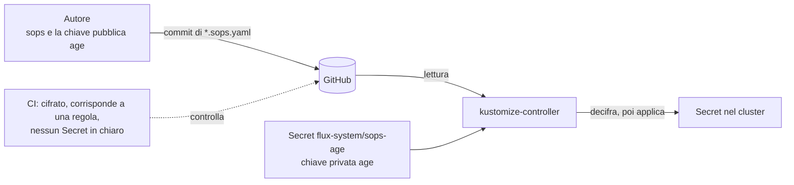

# Sicurezza e segreti

## SOPS e age { #sops-and-age }



Ogni Secret del repository è un file SOPS chiamato `*.sops.yaml`, cifrato per
un unico destinatario age. Le tre Kustomization di Flux li decifrano con la
chiave privata nel Secret `flux-system/sops-age`, creato fuori da Git al
bootstrap del cluster.

`.sops.yaml` sceglie i campi da cifrare in base al path del file:

| Path | Campi cifrati |
|---|---|
| `infrastructure/**/secret-*.sops.yaml` | `data`, `stringData` |
| `infrastructure/notifications/provider-telegram.sops.yaml` | tutto lo `spec` |
| `apps/**/secret-*.sops.yaml` | `data`, `stringData` |

Tutto il resto del file, come `metadata` e i nomi delle chiavi, resta
leggibile, ed è su questo che si basa la CI.

```bash
# sops legge la chiave privata age da ~/.config/sops/age/keys.txt,
# oppure dal file indicato in SOPS_AGE_KEY_FILE
export SOPS_AGE_KEY_FILE=/path/to/age.agekey

# Modificare un Secret esistente: lo decifra in un editor, lo ricifra al salvataggio
sops apps/<app>/secret-<nome>.sops.yaml

# Nuovo Secret: scrivere il manifest in chiaro nel path definitivo, poi
# cifrarlo sul posto prima di metterlo in stage
sops --encrypt --in-place apps/<app>/secret-<nome>.sops.yaml
```

!!! warning "I file più vecchi mantengono la propria regola"
    `sops` cifra con l'`encrypted_regex` salvato nel file, non con il
    `.sops.yaml` attuale. Alcuni file più vecchi hanno un elenco di nomi di
    campo diverso, quindi una chiave fuori da quell'elenco verrebbe salvata in
    chiaro, e la CI fallirebbe. Per portare un file alla regola attuale,
    decifralo sul posto e cifralo di nuovo (`sops --decrypt --in-place`, poi
    `sops --encrypt --in-place`), senza mettere in stage la versione in
    chiaro.

!!! tip "Conserva una copia della chiave privata age"
    La chiave esiste nel cluster e dove è stata salvata quando è stata
    creata. Senza di lei, nessun file cifrato di questo repository si può più
    leggere.

## Variabili postBuild { #postbuild-variables }

Flux sostituisce i riferimenti `${VAR}` in `infrastructure` e `apps` con i
valori di due Secret di `infrastructure/secrets/`:

- `cluster-vars`: `DOMAIN`, così il nome di dominio non compare mai in Git;
- `telegram-credentials`: `TELEGRAM_BOT_TOKEN`, per il provider Telegram di
  Flux.

`$${VAR}` protegge una variabile che l'applicazione espande da sola a
runtime: Gatus, per esempio, legge le credenziali OIDC e Telegram da variabili
d'ambiente. La CI esegue la sostituzione in modalità strict, con i
placeholder di `.github/ci/substitutions.yaml`, quindi una variabile non
definita fa fallire la pull request invece di diventare una stringa vuota.

I valori sostituiti finiscono in chiaro negli oggetti applicati, per esempio
in una ConfigMap. Una credenziale deve arrivare all'app tramite un Secret
(`valueFrom.secretKeyRef`), non tramite una variabile di sostituzione.

## Autenticazione { #authentication }

Authentik è l'identity provider, su `auth.${DOMAIN}`:

| Modalità | Come funziona | App |
|---|---|---|
| OIDC | l'app è un client OIDC di Authentik, issuer `https://auth.${DOMAIN}/application/o/<slug>/`; client ID e secret stanno in Secret SOPS | Grafana, Gatus, TREK |
| Forward auth | Traefik interroga l'outpost di Authentik prima di inoltrare una richiesta, vedi [Rete](networking.md#forward-auth) | Prometheus, dashboard di Traefik, code-server, `homelab.${DOMAIN}` |
| Login proprio | l'app gestisce l'autenticazione da sola | Home Assistant, Immich, social-media-reuploader (con un proprio client OAuth) |
| Utenti MQTT | file di password dal Secret `mqtt-auth` | Mosquitto |
| Nessuna | raggiungibile su un IP in LAN senza autenticazione | frontend di Zigbee2MQTT, API del Matter Server, porte delle metriche di Immich |

Authentik gira con una sola replica del server. Quando si ferma, ogni app
dietro OIDC o forward auth diventa irraggiungibile, compresa la pagina di
stato di Gatus.

## Pod Security

Talos impone lo standard di Pod Security `baseline` su ogni namespace, con
audit e warning al livello `restricted`; `kube-system` è esente. Questi
namespace hanno la label `privileged`:

| Namespace | Perché |
|---|---|
| `metallb` | gli speaker e FRR-K8s usano la rete dell'host |
| `prometheus` | node-exporter usa la rete dell'host, il namespace PID dell'host e path dell'host |
| `home-assistant` | rete dell'host per il discovery dei dispositivi |
| `home-assistant-matter-server` | rete dell'host per il discovery di Matter; un post-renderer toglie la modalità privilegiata che il chart imposta sul container |
| `immich` | il container del server è privilegiato per usare la iGPU (`/dev/dri`) |
| `zigbee2mqtt` | il container è privilegiato, con `SYS_ADMIN`, per accedere all'adattatore USB |
| `crd-ns`, `nfs-csi` | nessun motivo: entrambi i namespace sono vuoti |

Un container privilegiato equivale a root sul suo nodo.

## Rete { #network }

- flannel non applica le NetworkPolicy, quindi dentro il cluster non c'è
  segmentazione: un pod compromesso raggiunge ogni database, il broker MQTT e
  ogni API interna.
- I servizi sugli IP in LAN sono raggiungibili da ogni dispositivo della rete
  di casa; vedi [Rete](networking.md#lan-addresses).
- Il TLS termina su Traefik; il traffico da Traefik ai pod è HTTP in chiaro
  dentro il cluster.

## Supply chain

- helm-controller applica ogni chart con i permessi di cluster-admin, quindi
  le sorgenti dei chart contano. La CI rifiuta le HelmRelease senza una
  versione esatta del chart e le immagini senza tag o digest; le
  GitRepository che seguono un branch sono segnalate come warning.
- Renovate fa l'automerge degli aggiornamenti minor e patch di chart,
  immagini e GitHub Actions solo tre giorni dopo la loro release, e solo se
  `ci-gate` passa. Vedi [Flusso delle modifiche](workflow.md#renovate).
- Sulle pull request girano anche GitGuardian, la dependency review di GitHub,
  actionlint e zizmor sui workflow. Dopo ogni merge e ogni notte, `ci-main`
  analizza il repository con Trivy e carica i risultati nel code scanning.

## Lacune note

| Lacuna | Effetto |
|---|---|
| Nessun backup | vedi [Storage](storage.md#backups) |
| NetworkPolicy non applicate | nessun isolamento tra i pod |
| Endpoint senza autenticazione in LAN | i dispositivi Zigbee e Matter si possono comandare da qualsiasi dispositivo della rete di casa |
| Un solo destinatario age | perdere quella chiave significa perdere tutti i file cifrati |
| Container privilegiati | una compromissione di Immich o Zigbee2MQTT arriva al nodo |
| Una sola replica di Authentik | l'SSO e tutte le app protette si fermano insieme |
