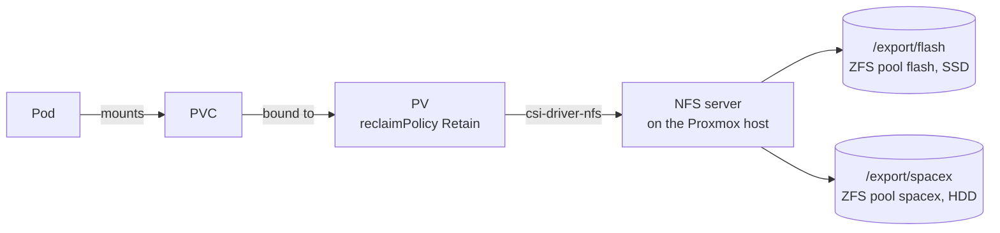

# Storage



Every persistent volume is a directory on the Proxmox host, served over NFS by
the host itself and mounted by the CSI driver
[`csi-driver-nfs`](infrastructure.md#nfs-csi). There is no block storage.

## NFS server

The Proxmox host (`192.168.178.162`) exports two directories:

- `/export/flash`, on the ZFS pool `flash`: a mirror of two SATA SSDs. The
  disks of the three VMs, the etcd disk included, live on this pool too.
- `/export/spacex`, on the ZFS pool `spacex`: a RAIDZ of hard disks, with an
  Optane SSD as read cache.

The ZFS exporter on the host reports the health and the fill level of both
pools to Prometheus (see [Monitoring](monitoring.md#alert-rules)).

## StorageClasses { #storageclasses }

| Name | NFS export | Disks | Used for |
|---|---|---|---|
| `nfs-flash` | `/export/flash` | SSD | databases, Prometheus, small app data |
| `nfs-spacex` | `/export/spacex` | HDD | photo library, home automation configuration, Grafana and Gatus data |

Both classes share the same settings:

- provisioner `nfs.csi.k8s.io`;
- `reclaimPolicy: Retain`: deleting a PVC never deletes its files, the PV
  becomes `Released`;
- `volumeBindingMode: WaitForFirstConsumer`: a PVC stays `Pending` until a pod
  uses it;
- `allowVolumeExpansion: true`. NFS does not enforce the requested size: a
  volume can grow until its pool is full;
- neither is the default class, so every PVC, and every chart value that
  creates one, names its class.

## Volume directories { #volume-directories }

Each volume is the directory `/export/<pool>/<namespace>/<pvc-name>`. The
StorageClasses set it with the `subDir` parameter, written
`$${pvc.metadata.namespace}/$${pvc.metadata.name}` in Git so that Flux
substitution leaves it to the CSI driver. As a consequence:

- a PVC deleted and created again with the same name, in the same namespace,
  gets the same directory and finds the old data;
- most `Released` PVs are **aliases**: they point at the directory of a PV
  that is `Bound` today. Deleting such a PV object is harmless; deleting its
  directory destroys live data;
- the read-only script `hack/inventory-released-pvs.py` lists the PVs that
  are not `Bound` and tells aliases from orphans, with the size and the last
  change of each orphan directory.

!!! danger "Never switch a Released PV to `Delete`"
    With `reclaimPolicy: Delete` the CSI driver removes the directory of the
    PV, which for an alias is the directory of a live volume. Directories are
    deleted only by hand, as described in [Retiring an app](retiring-an-app.md).

## Data protection { #data-protection }

| Safeguard | What it prevents | Where |
|---|---|---|
| `reclaimPolicy: Retain` | deleting a PVC deletes its files | both StorageClasses |
| `kustomize.toolkit.fluxcd.io/prune: disabled` | Flux deletes an object that was removed from Git | PVCs and Namespaces of stateful apps, CloudNativePG clusters in Git, CRDs |
| `deletionPolicy: Orphan` | deleting a Flux Kustomization deletes everything it applied | `secrets`, `infrastructure`, `apps` |
| `helm.sh/resource-policy: keep` | Helm deletes the PVCs it created when the release is removed | `mosquitto-data`, `social-media-reuploader-data`, and the data kept from TeslaMate |
| CI data guard | a pull request removes PVCs, Namespaces, CloudNativePG clusters or HelmReleases, or changes a volume | `render` job of `ci.yaml`; the `allow-destructive` label turns it into a warning |

What protects a PVC depends on what creates it:

- **Flux**, from a `pvc.yaml`: the prune annotation. CI warns when it is
  missing.
- **A Helm chart template** (`mosquitto-data`, `social-media-reuploader-data`):
  Helm deletes it with the release, unless it carries
  `helm.sh/resource-policy: keep`; today both of them do.
- **A StatefulSet volume claim template** (Home Assistant, Matter Server,
  Zigbee2MQTT, the PostgreSQL of Authentik, Prometheus, Alertmanager):
  Kubernetes keeps these PVCs when the StatefulSet is deleted.
- **CloudNativePG**: the PVCs belong to the `Cluster` object and are deleted
  together with it.

In every case `Retain` keeps the files on the NFS host. The other safeguards
keep the Kubernetes objects too, so that no volume has to be bound again by
hand.

## Volumes in use { #volumes }

Sizes are the requested ones; access modes: RWX ReadWriteMany, RWO
ReadWriteOnce. The `teslamate` volumes belong to an app removed from Git and
are kept until the date in `.github/ci/retention.yaml` (see
[Retiring an app](retiring-an-app.md)).

| Namespace | PVC | Class | Size | Access | Created by |
|---|---|---|---|---|---|
| `authentik` | `data-authentik-postgresql-0` | `nfs-flash` | 10Gi | RWX | StatefulSet |
| `authentik` | `authentik-media`, `authentik-certs`, `authentik-templates` | `nfs-spacex` | 10Gi, 1Gi, 1Gi | RWX | Flux (never mounted, `Pending`) |
| `gatus` | `gatus-data` | `nfs-spacex` | 200Mi | RWX | Flux |
| `grafana` | `grafana-storage` | `nfs-spacex` | 1Gi | RWX | Flux |
| `home-assistant` | `home-assistant-home-assistant-0` | `nfs-spacex` | 5Gi | RWX | StatefulSet |
| `home-assistant-matter-server` | `data-home-assistant-matter-server-0` | `nfs-spacex` | 2Gi | RWO | StatefulSet |
| `immich` | `immich-library` | `nfs-spacex` | 1T | RWX | Flux |
| `immich` | `immich-machine-learning-cache`, `immich-valkey` | `nfs-flash` | 20Gi, 1Gi | RWX | Flux |
| `immich` | `immich-pg-1`, `immich-pg-2` | `nfs-flash` | 32Gi each | RWO | CloudNativePG |
| `media` | `media-data` | `nfs-spacex` | 1Ti | RWX | Flux |
| `media` | `soulsync-config`, `slskd-config`, `prowlarr-config`, `transmission-config` | `nfs-flash` | 5Gi, 2Gi, 1Gi, 1Gi | RWX | Flux |
| `mqtt` | `mosquitto-data` | `nfs-spacex` | 1Gi | RWX | Helm chart, with `keep` |
| `prometheus` | Prometheus and Alertmanager data | `nfs-flash` | 20Gi, 2Gi | RWO | StatefulSet (operator) |
| `social-media-reuploader` | `social-media-reuploader-data` | `nfs-flash` | 1Gi | RWO | Helm chart, with `keep` |
| `teslamate` | `teslamate-db-1`, `teslamate-db-2` | `nfs-flash` | 5Gi each | RWO | retained: CloudNativePG cluster, hibernated |
| `teslamate` | `teslamate-grafana` | `nfs-flash` | 1Gi | RWX | retained: former Helm chart PVC, with `keep` |
| `trek` | `trek-data`, `trek-uploads` | `nfs-flash` | 10Gi, 20Gi | RWX | Flux |
| `zigbee2mqtt` | `data-volume-zigbee2mqtt-0` | `nfs-spacex` | 1Gi | RWO | StatefulSet |

## Databases on NFS

- **CloudNativePG** runs `immich-pg` with two instances. Both run on the same
  worker today and write to the same export: the second instance covers the
  failure of a PostgreSQL instance, not of the node or of the pool, and it
  doubles the writes on `flash`.
- **Authentik** uses the PostgreSQL bundled with its chart, a single pod.
- **SQLite** files on NFS: Gatus, Grafana and the Home Assistant recorder.
- **Prometheus** keeps its time series database on NFS, which Prometheus
  reports as an unsupported filesystem at startup.
- `ReadWriteOnce` is not enforced across nodes: the NFS CSIDriver has
  `attachRequired: false`, so a pod on another node can mount a volume that is
  already in use. Apps with a single writer, such as Gatus, Grafana and
  code-server, use the `Recreate` update strategy, so that the old pod stops
  before the new one starts.

## Backups { #backups }

!!! danger "There are no backups"
    - no ZFS snapshots of the exported datasets;
    - no CloudNativePG backups (`Backup` or `ScheduledBackup`) and no WAL
      archive;
    - no etcd snapshots;
    - no Proxmox backup jobs for the VMs;
    - no copy of any data outside the host.

    Immich writes a nightly database dump, but into its own library, on the
    same pool as the photos. ZFS redundancy covers a failed disk and `Retain`
    covers a deleted PVC. A wrong `rm`, a failed migration, a lost pool or a
    lost host destroy the only copy.

## Checking space

```text
# Prometheus, fill level of the ZFS pools (0 to 1)
zfs_pool_allocated_bytes / zfs_pool_size_bytes
```

```bash
# On the Proxmox host
zpool list flash spacex
```

The `ZfsPoolNearFull` and `ZfsPoolCritical` alerts fire above 80% and 90%. The
`PvcAlmostFull` alerts read the kubelet volume statistics, which for an NFS
volume describe the whole export, not the single directory.
