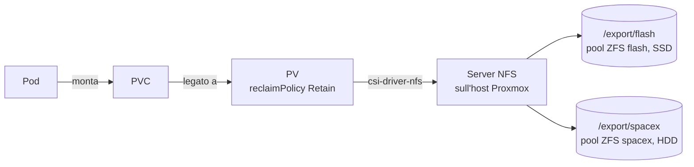

# Storage



Ogni volume persistente è una directory sull'host Proxmox, servita via NFS
dall'host stesso e montata dal driver CSI
[`csi-driver-nfs`](infrastructure.md#nfs-csi). Non c'è storage a blocchi.

## Server NFS

L'host Proxmox (`192.168.178.162`) esporta due directory:

- `/export/flash`, sul pool ZFS `flash`: un mirror di due SSD SATA. Su questo
  pool stanno anche i dischi delle tre VM, compreso quello di etcd.
- `/export/spacex`, sul pool ZFS `spacex`: un RAIDZ di dischi rigidi, con un
  SSD Optane come cache di lettura.

L'exporter ZFS sull'host comunica a Prometheus lo stato e il riempimento di
entrambi i pool (vedi [Monitoraggio](monitoring.md#alert-rules)).

## StorageClass { #storageclasses }

| Nome | Export NFS | Dischi | Usata per |
|---|---|---|---|
| `nfs-flash` | `/export/flash` | SSD | database, Prometheus, dati piccoli delle app |
| `nfs-spacex` | `/export/spacex` | HDD | libreria delle foto, configurazione della domotica, dati di Grafana e Gatus |

Le due classi hanno le stesse impostazioni:

- provisioner `nfs.csi.k8s.io`;
- `reclaimPolicy: Retain`: cancellare un PVC non cancella mai i suoi file, il
  PV diventa `Released`;
- `volumeBindingMode: WaitForFirstConsumer`: un PVC resta `Pending` finché un
  pod non lo usa;
- `allowVolumeExpansion: true`. NFS non impone la dimensione richiesta: un
  volume può crescere fino a riempire il suo pool;
- nessuna delle due è la classe di default, quindi ogni PVC, e ogni value di
  un chart che ne crea uno, indica la propria classe.

## Directory dei volumi { #volume-directories }

Ogni volume è la directory `/export/<pool>/<namespace>/<nome-pvc>`. Le
StorageClass la impostano con il parametro `subDir`, scritto
`$${pvc.metadata.namespace}/$${pvc.metadata.name}` in Git perché la
sostituzione di Flux lo lasci al driver CSI. Di conseguenza:

- un PVC cancellato e ricreato con lo stesso nome, nello stesso namespace,
  riceve la stessa directory e ritrova i vecchi dati;
- la maggior parte dei PV `Released` sono **alias**: puntano alla directory di
  un PV che oggi è `Bound`. Cancellare l'oggetto PV non fa danni; cancellarne
  la directory distrugge dati in uso;
- lo script in sola lettura `hack/inventory-released-pvs.py` elenca i PV che
  non sono `Bound` e distingue gli alias dagli orfani, con dimensione e ultima
  modifica di ogni directory orfana.

!!! danger "Mai portare un PV Released a `Delete`"
    Con `reclaimPolicy: Delete` il driver CSI rimuove la directory del PV, che
    per un alias è la directory di un volume in uso. Le directory si cancellano
    solo a mano, come descritto in [Dismettere un'app](retiring-an-app.md).

## Protezione dei dati { #data-protection }

| Protezione | Cosa impedisce | Dove |
|---|---|---|
| `reclaimPolicy: Retain` | che cancellare un PVC ne cancelli i file | entrambe le StorageClass |
| `kustomize.toolkit.fluxcd.io/prune: disabled` | che Flux cancelli un oggetto rimosso da Git | PVC e Namespace delle app con stato, cluster CloudNativePG in Git, CRD |
| `deletionPolicy: Orphan` | che cancellare una Kustomization di Flux cancelli tutto ciò che aveva applicato | `secrets`, `infrastructure`, `apps` |
| `helm.sh/resource-policy: keep` | che Helm cancelli i PVC creati da lui quando la release viene rimossa | `mosquitto-data`, `social-media-reuploader-data`, e i dati conservati di TeslaMate |
| data guard della CI | che una pull request rimuova PVC, Namespace, cluster CloudNativePG o HelmRelease, o modifichi un volume | job `render` di `ci.yaml`; la label `allow-destructive` lo trasforma in un warning |

Cosa protegge un PVC dipende da chi lo crea:

- **Flux**, da un `pvc.yaml`: l'annotazione di prune. La CI avvisa quando
  manca.
- **Un template di un chart Helm** (`mosquitto-data`,
  `social-media-reuploader-data`): Helm lo cancella insieme alla release, a
  meno che non abbia `helm.sh/resource-policy: keep`; oggi ce l'hanno
  entrambi.
- **Un volume claim template di uno StatefulSet** (Home Assistant, Matter
  Server, Zigbee2MQTT, il PostgreSQL di Authentik, Prometheus, Alertmanager):
  Kubernetes mantiene questi PVC quando lo StatefulSet viene cancellato.
- **CloudNativePG**: i PVC appartengono all'oggetto `Cluster` e vengono
  cancellati insieme a lui.

In tutti i casi `Retain` conserva i file sull'host NFS. Le altre protezioni
conservano anche gli oggetti Kubernetes, così nessun volume va ricollegato a
mano.

## Volumi in uso { #volumes }

Le dimensioni sono quelle richieste; modalità di accesso: RWX ReadWriteMany,
RWO ReadWriteOnce. I volumi di `teslamate` appartengono a un'app rimossa da Git
e si conservano fino alla data indicata in `.github/ci/retention.yaml` (vedi
[Dismettere un'app](retiring-an-app.md)).

| Namespace | PVC | Classe | Dimensione | Accesso | Creato da |
|---|---|---|---|---|---|
| `authentik` | `data-authentik-postgresql-0` | `nfs-flash` | 10Gi | RWX | StatefulSet |
| `authentik` | `authentik-media`, `authentik-certs`, `authentik-templates` | `nfs-spacex` | 10Gi, 1Gi, 1Gi | RWX | Flux (mai montati, `Pending`) |
| `gatus` | `gatus-data` | `nfs-spacex` | 200Mi | RWX | Flux |
| `grafana` | `grafana-storage` | `nfs-spacex` | 1Gi | RWX | Flux |
| `home-assistant` | `home-assistant-home-assistant-0` | `nfs-spacex` | 5Gi | RWX | StatefulSet |
| `home-assistant-matter-server` | `data-home-assistant-matter-server-0` | `nfs-spacex` | 2Gi | RWO | StatefulSet |
| `immich` | `immich-library` | `nfs-spacex` | 1T | RWX | Flux |
| `immich` | `immich-machine-learning-cache`, `immich-valkey` | `nfs-flash` | 20Gi, 1Gi | RWX | Flux |
| `immich` | `immich-pg-1`, `immich-pg-2` | `nfs-flash` | 32Gi ciascuno | RWO | CloudNativePG |
| `mqtt` | `mosquitto-data` | `nfs-spacex` | 1Gi | RWX | chart Helm, con `keep` |
| `prometheus` | dati di Prometheus e Alertmanager | `nfs-flash` | 20Gi, 2Gi | RWO | StatefulSet (operatore) |
| `social-media-reuploader` | `social-media-reuploader-data` | `nfs-flash` | 1Gi | RWO | chart Helm, con `keep` |
| `teslamate` | `teslamate-db-1`, `teslamate-db-2` | `nfs-flash` | 5Gi ciascuno | RWO | conservati: cluster CloudNativePG in ibernazione |
| `teslamate` | `teslamate-grafana` | `nfs-flash` | 1Gi | RWX | conservato: ex PVC del chart Helm, con `keep` |
| `trek` | `trek-data`, `trek-uploads` | `nfs-flash` | 10Gi, 20Gi | RWX | Flux |
| `zigbee2mqtt` | `data-volume-zigbee2mqtt-0` | `nfs-spacex` | 1Gi | RWO | StatefulSet |

## Database su NFS

- **CloudNativePG** esegue `immich-pg` con due istanze. Oggi girano entrambe
  sullo stesso worker e scrivono sullo stesso export: la seconda istanza copre
  il guasto di un'istanza PostgreSQL, non quello del nodo o del pool, e
  raddoppia le scritture su `flash`.
- **Authentik** usa il PostgreSQL incluso nel suo chart, un solo pod.
- **File SQLite** su NFS: Gatus, Grafana e il recorder di Home Assistant.
- **Prometheus** tiene il database delle serie temporali su NFS, che
  Prometheus stesso segnala all'avvio come filesystem non supportato.
- `ReadWriteOnce` non è imposto tra nodi diversi: il CSIDriver NFS ha
  `attachRequired: false`, quindi un pod su un altro nodo può montare un volume
  già in uso. Le app con un solo writer, come Gatus, Grafana e code-server,
  usano la strategia di aggiornamento `Recreate`, così il vecchio pod si ferma
  prima che parta il nuovo.

## Backup { #backups }

!!! danger "Non esistono backup"
    - nessuno snapshot ZFS dei dataset esportati;
    - nessun backup di CloudNativePG (`Backup` o `ScheduledBackup`) e nessun
      archivio dei WAL;
    - nessuno snapshot di etcd;
    - nessun job di backup di Proxmox per le VM;
    - nessuna copia di alcun dato fuori dall'host.

    Immich scrive ogni notte un dump del database, ma dentro la propria
    libreria, sullo stesso pool delle foto. La ridondanza di ZFS copre un disco
    guasto e `Retain` copre un PVC cancellato. Un `rm` sbagliato, una
    migrazione fallita, un pool perso o un host perso distruggono l'unica
    copia.

## Controllare lo spazio

```text
# Prometheus, riempimento dei pool ZFS (da 0 a 1)
zfs_pool_allocated_bytes / zfs_pool_size_bytes
```

```bash
# Sull'host Proxmox
zpool list flash spacex
```

Gli alert `ZfsPoolNearFull` e `ZfsPoolCritical` scattano oltre l'80% e il 90%.
Gli alert `PvcAlmostFull` leggono le statistiche dei volumi del kubelet, che
per un volume NFS descrivono l'intero export, non la singola directory.
