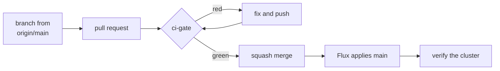

# Change workflow

Flux applies whatever is on `main`, so a change reaches the cluster only by
reaching `main`. A ruleset protects the branch: changes arrive as pull
requests merged with squash, the required checks are `ci-gate` and GitGuardian,
the branch must be up to date with `main`, history stays linear and force
pushes are blocked.



## Steps

1. **Branch** from the latest `main`:

    ```bash
    git fetch origin
    git switch -c fix/gatus-alerts origin/main
    ```

2. **Change** as little as needed, in the style of the repository: the layout
   of [an app directory](apps.md#app-layout), pinned chart
   versions and image tags, comments in English.
3. **Validate** locally:

    ```bash
    kubectl kustomize apps/ >/dev/null
    kubectl kustomize infrastructure/ >/dev/null
    # for a HelmRelease: render the chart with its values
    helm template <release> <repo>/<chart> --version <version> -f values.yaml
    ```

    The whole CI runs locally too: `mise install` for the tools, then the
    `fluxci` commands in
    [`.github/ci/README.md`](https://github.com/lucaam/k8s-iannamo/blob/main/.github/ci/README.md).

4. **Commit** with a conventional message (`fix(gatus): ...`), push the
   branch and open the pull request. Its description covers the context, the
   verification done, the risks and the rollback.
5. **CI** runs on the pull request. Fix until `ci-gate` is green, and read the
   diff comment: it shows what changes in the rendered manifests.
6. **Merge** with squash. The owner merges.
7. **Update the local clone and reconcile.** Without the reconcile commands
   Flux fetches `main` within a minute and applies it within ten minutes.

    ```bash
    git switch main && git pull --ff-only
    flux reconcile source git flux-system
    flux reconcile kustomization apps      # or infrastructure, or secrets
    flux reconcile helmrelease <name> -n <namespace>   # to upgrade a release now
    ```

8. **Verify**:

    ```bash
    flux get kustomizations
    flux get helmreleases -A
    kubectl -n <namespace> get pods
    kubectl -n <namespace> logs deploy/<name>
    ```

## What CI checks { #ci }

| Workflow | Runs | What it does |
|---|---|---|
| `ci.yaml` | every pull request | the gate described below |
| `ci-main.yaml` | after every merge, every night, on demand | build and render of every HelmRelease, external chart sources included, and a Trivy scan to code scanning. A failure opens or updates the issue labelled `ci-main`. It also opens a `data-retention` issue when retained data passes its date (see [Retiring an app](retiring-an-app.md)) |
| `docs.yml` | merges that touch the docs | builds and publishes this site |

Jobs of the pull request gate:

| Job | When | What it does |
|---|---|---|
| `changes` | always | picks the jobs to run from the changed files |
| `lint` | always | `yamllint --strict` on the whole repository, actionlint, zizmor, dependency review, the data retention registry, the fluxci unit tests; the Renovate validator when `.github/renovate.json` changes; `mkdocs build --strict` when the docs change |
| `manifests` | manifests or CI changed | `fluxci build` of every Flux Kustomization, static checks, kubeconform and conftest |
| `render` | manifests or CI changed | `helm template` of the changed HelmReleases for the base and the head, validation, data guard and diff |
| `diff comment` | after `render` | posts the diff on the pull request, informative only |
| `ci-gate` | always | fails when `changes`, `lint`, `manifests` or `render` failed or was cancelled |

`render` covers every HelmRelease, not only the changed ones, when the pull
request touches the CI, `policy/`, `mise.toml`, `clusters/` or
`infrastructure/crds/`, or carries the `ci-full-render` label.

What `fluxci` verifies, without access to the cluster:

- **Substitution** of the postBuild variables in strict mode, with
  placeholders from `.github/ci/substitutions.yaml` for the variables that
  come from SOPS Secrets.
- **Secrets**: every `*.sops.yaml` is encrypted, matches a `.sops.yaml` rule
  and holds no plaintext value; no plaintext Secret exists anywhere.
- **References**: `dependsOn`, chart sources and `valuesFrom` point at objects
  that exist; SOPS files sit only in Kustomizations with decryption; no object
  is applied by two Kustomizations.
- **Warnings** for files that no Kustomization applies and for PVCs and
  CloudNativePG clusters without prune protection.
- **Schemas**: kubeconform in strict mode, with schemas generated from the
  CRDs of the repository, of the charts and of Flux; charts are rendered as
  helm-controller renders them.
- **Policies** in `policy/`: `deny` images without a tag or a digest and
  charts without an exact version; `warn` about privileged containers,
  hostPath volumes, missing memory requests, namespaces without a Pod Security
  level and GitRepositories that follow a branch. Known exceptions are listed,
  with a reason, in `policy/exceptions.rego`.

### Data guard { #data-guard }

The guard compares base and head, both the objects Flux applies and the
rendered charts, and fails a pull request that:

- removes a PVC, PV, Namespace, CloudNativePG cluster, StorageClass,
  HelmRelease, Flux Kustomization or StatefulSet with volume claim templates;
- changes the class, access modes or volume of a PVC, the volume claim
  templates of a StatefulSet, or the storage or bootstrap of a CloudNativePG
  cluster;
- enables prune on a Kustomization, changes its path or target namespace, or
  changes a release name or target namespace;
- moves a protected object to another Kustomization, removes
  `kustomize.toolkit.fluxcd.io/prune: disabled`, or introduces a `Delete`
  reclaim policy.

When the change is intended, and the data has been protected first, the
`allow-destructive` label turns the findings into warnings. See
[Retiring an app](retiring-an-app.md).

## Renovate { #renovate }

Renovate (`.github/renovate.json`) opens pull requests for:

- the chart versions of the HelmReleases and the Git tag of the TREK chart;
- container images, in chart values and in plain manifests;
- the release URLs of the Gateway API CRDs and of CloudNativePG;
- GitHub Actions, pinned to digests;
- the tools in `mise.toml` and the MkDocs packages of this site
  (`.github/ci/docs-requirements.txt`).

It ignores the disabled apps, the SOPS files and
`clusters/production/flux-system/`: Flux is not managed from Git (see
[Architecture](architecture.md#gitops-with-flux)), so a bump there would not
reach the cluster. At most ten of its pull requests are open at a time, and at
most two are opened per hour; the Dependency Dashboard issue lists everything
it tracks.

| Update | Merge |
|---|---|
| Helm charts and container images, minor and patch | automerge three days after the release, when `ci-gate` passes |
| Home automation stack (Home Assistant, code-server, Matter Server, Zigbee2MQTT, Mosquitto), minor, patch and digest | one grouped pull request, automerged three days after the release and only between 02:00 and 06:00 (Europe/Rome), so Home Assistant restarts once |
| GitHub Actions, minor, patch and digest | automerge three days after the release, when `ci-gate` passes |
| Any major update | review |
| PostgreSQL server images, major | never proposed: a new major needs a planned migration of the data |
| Authentik, CloudNativePG, Flux, Traefik | always review |
| cert-manager, MetalLB, csi-driver-nfs, kube-prometheus-stack, Gateway API | always review |
| Immich, paperless-ngx (data migrations) | always review |
| TREK and social-media-reuploader: chart and image in one pull request | always review |

## Rolling back { #rollback }

- Revert the merge commit with a new pull request: `git revert <sha>` on a
  branch created from `origin/main`. Flux applies the revert like any other
  change.
- Reverting a chart does not undo the data migrations it ran: an app that
  migrated its database during an upgrade may not start on the old version.
  Read the release notes before reverting a major upgrade.
- In an emergency, `flux suspend helmrelease <name> -n <namespace>` stops Flux
  from touching a release while it is fixed by hand, for example with
  `helm rollback`. Put the fix in Git, then `flux resume helmrelease`. While a
  release is suspended, the cluster and Git disagree.
