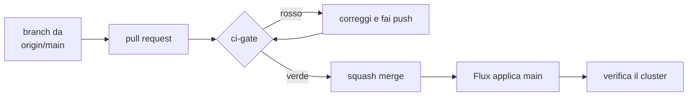

# Flusso delle modifiche

Flux applica qualsiasi cosa ci sia su `main`, quindi una modifica arriva al
cluster solo arrivando su `main`. Un ruleset protegge il branch: le modifiche
arrivano come pull request unite con squash, i check obbligatori sono
`ci-gate` e GitGuardian, il branch deve essere aggiornato rispetto a `main`, la
storia resta lineare e i force push sono bloccati.



## Passi

1. **Branch** dall'ultimo `main`:

    ```bash
    git fetch origin
    git switch -c fix/gatus-alerts origin/main
    ```

2. **Modifica** il minimo necessario, nello stile del repository: la
   struttura di [una directory di app](apps.md#app-layout), versioni dei chart
   e tag delle immagini fissati, commenti in inglese.
3. **Valida** in locale:

    ```bash
    kubectl kustomize apps/ >/dev/null
    kubectl kustomize infrastructure/ >/dev/null
    # per una HelmRelease: renderizza il chart con i suoi values
    helm template <release> <repo>/<chart> --version <versione> -f values.yaml
    ```

    Anche tutta la CI gira in locale: `mise install` per i tool, poi i comandi
    `fluxci` di
    [`.github/ci/README.md`](https://github.com/lucaam/k8s-iannamo/blob/main/.github/ci/README.md).

4. **Commit** con un messaggio convenzionale (`fix(gatus): ...`), push del
   branch e apertura della pull request. La descrizione copre il contesto, le
   verifiche fatte, i rischi e il rollback.
5. **CI**: gira sulla pull request. Correggi finché `ci-gate` non è verde, e
   leggi il commento con il diff: mostra cosa cambia nei manifest
   renderizzati.
6. **Merge** con squash. Il merge lo fa il proprietario.
7. **Aggiorna il clone locale e riconcilia.** Senza i comandi di
   riconciliazione, Flux legge `main` entro un minuto e lo applica entro dieci
   minuti.

    ```bash
    git switch main && git pull --ff-only
    flux reconcile source git flux-system
    flux reconcile kustomization apps      # oppure infrastructure, oppure secrets
    flux reconcile helmrelease <nome> -n <namespace>   # per aggiornare subito una release
    ```

8. **Verifica**:

    ```bash
    flux get kustomizations
    flux get helmreleases -A
    kubectl -n <namespace> get pods
    kubectl -n <namespace> logs deploy/<nome>
    ```

## Cosa controlla la CI { #ci }

| Workflow | Quando gira | Cosa fa |
|---|---|---|
| `ci.yaml` | a ogni pull request | il gate descritto qui sotto |
| `ci-main.yaml` | dopo ogni merge, ogni notte, su richiesta | build e render di tutte le HelmRelease, sorgenti esterne dei chart comprese, e una scansione Trivy verso il code scanning. Un fallimento apre o aggiorna la issue con label `ci-main`. Apre anche una issue `data-retention` quando dei dati conservati superano la loro data (vedi [Dismettere un'app](retiring-an-app.md)) |
| `docs.yml` | merge che toccano la documentazione | costruisce e pubblica questo sito |

Job del gate delle pull request:

| Job | Quando | Cosa fa |
|---|---|---|
| `changes` | sempre | sceglie i job da eseguire in base ai file modificati |
| `lint` | sempre | `yamllint --strict` su tutto il repository, actionlint, zizmor, dependency review, il registro della data retention, gli unit test di fluxci; il validatore di Renovate quando cambia `.github/renovate.json`; `mkdocs build --strict` quando cambia la documentazione |
| `manifests` | se cambiano manifest o CI | `fluxci build` di ogni Kustomization di Flux, controlli statici, kubeconform e conftest |
| `render` | se cambiano manifest o CI | `helm template` delle HelmRelease modificate, per la base e per la head, validazione, data guard e diff |
| `diff comment` | dopo `render` | pubblica il diff sulla pull request, solo informativo |
| `ci-gate` | sempre | fallisce se `changes`, `lint`, `manifests` o `render` sono falliti o sono stati annullati |

`render` copre tutte le HelmRelease, non solo quelle modificate, quando la
pull request tocca la CI, `policy/`, `mise.toml`, `clusters/` o
`infrastructure/crds/`, oppure ha la label `ci-full-render`.

Cosa verifica `fluxci`, senza accesso al cluster:

- **Sostituzione** delle variabili postBuild in modalità strict, con i
  placeholder di `.github/ci/substitutions.yaml` per le variabili che arrivano
  da Secret SOPS.
- **Segreti**: ogni `*.sops.yaml` è cifrato, corrisponde a una regola di
  `.sops.yaml` e non contiene valori in chiaro; non esiste nessun Secret in
  chiaro.
- **Riferimenti**: `dependsOn`, sorgenti dei chart e `valuesFrom` puntano a
  oggetti che esistono; i file SOPS stanno solo in Kustomization con la
  decifratura; nessun oggetto è applicato da due Kustomization.
- **Warning** per i file che nessuna Kustomization applica e per i PVC e i
  cluster CloudNativePG senza protezione dal prune.
- **Schemi**: kubeconform in modalità strict, con schemi generati dalle CRD
  del repository, dei chart e di Flux; i chart sono renderizzati come li
  renderizza helm-controller.
- **Policy** in `policy/`: `deny` per le immagini senza tag o digest e per i
  chart senza una versione esatta; `warn` per container privilegiati, volumi
  hostPath, memory request mancanti, namespace senza livello di Pod Security e
  GitRepository che seguono un branch. Le eccezioni note sono elencate, con il
  motivo, in `policy/exceptions.rego`.

### Data guard { #data-guard }

Il guard confronta base e head, sia gli oggetti che Flux applica sia i chart
renderizzati, e fa fallire una pull request che:

- rimuove un PVC, un PV, un Namespace, un cluster CloudNativePG, una
  StorageClass, una HelmRelease, una Kustomization di Flux o uno StatefulSet
  con volume claim template;
- cambia la classe, le modalità di accesso o il volume di un PVC, i volume
  claim template di uno StatefulSet, oppure lo storage o il bootstrap di un
  cluster CloudNativePG;
- attiva il prune su una Kustomization, ne cambia il path o il namespace di
  destinazione, oppure cambia il nome o il namespace di una release;
- sposta un oggetto protetto in un'altra Kustomization, rimuove
  `kustomize.toolkit.fluxcd.io/prune: disabled` o introduce una reclaim
  policy `Delete`.

Quando la modifica è voluta, e i dati sono stati protetti prima, la label
`allow-destructive` trasforma i risultati in warning. Vedi
[Dismettere un'app](retiring-an-app.md).

## Renovate { #renovate }

Renovate (`.github/renovate.json`) apre pull request per:

- le versioni dei chart delle HelmRelease e il tag Git del chart di TREK;
- le immagini dei container, nei values dei chart e nei manifest semplici;
- gli URL di release delle CRD della Gateway API e di CloudNativePG;
- le GitHub Actions, fissate per digest;
- i tool di `mise.toml` e i pacchetti MkDocs di questo sito
  (`.github/ci/docs-requirements.txt`).

Ignora le app disattivate, i file SOPS e `clusters/production/flux-system/`:
Flux non è gestito da Git (vedi
[Architettura](architecture.md#gitops-with-flux)), quindi un aggiornamento lì
non arriverebbe al cluster. Tiene aperte al massimo dieci pull request alla
volta e ne apre al massimo due all'ora; la issue Dependency Dashboard elenca
tutto ciò che segue.

| Aggiornamento | Merge |
|---|---|
| Chart Helm e immagini dei container, minor e patch | automerge tre giorni dopo la release, se `ci-gate` passa |
| Stack della domotica (Home Assistant, code-server, Matter Server, Zigbee2MQTT, Mosquitto), minor, patch e digest | una sola pull request raggruppata, con automerge tre giorni dopo la release e solo tra le 02:00 e le 06:00 (Europe/Rome), così Home Assistant si riavvia una volta sola |
| GitHub Actions, minor, patch e digest | automerge tre giorni dopo la release, se `ci-gate` passa |
| Qualsiasi major | revisione |
| Immagini dei server PostgreSQL, major | mai proposte: una nuova major richiede una migrazione pianificata dei dati |
| Authentik, CloudNativePG, Flux, Traefik | sempre revisione |
| cert-manager, MetalLB, csi-driver-nfs, kube-prometheus-stack, Gateway API | sempre revisione |
| Immich, paperless-ngx (migrazioni dei dati) | sempre revisione |
| TREK e social-media-reuploader: chart e immagine nella stessa pull request | sempre revisione |

## Tornare indietro { #rollback }

- Fai il revert del commit di merge con una nuova pull request:
  `git revert <sha>` su un branch creato da `origin/main`. Flux applica il
  revert come qualsiasi altra modifica.
- Fare il revert di un chart non annulla le migrazioni di dati che ha
  eseguito: un'app che ha migrato il database durante un upgrade potrebbe non
  partire con la versione precedente. Leggi le release note prima di fare il
  revert di un upgrade major.
- In emergenza, `flux suspend helmrelease <nome> -n <namespace>` impedisce a
  Flux di toccare una release mentre la si sistema a mano, per esempio con
  `helm rollback`. Porta la correzione in Git, poi `flux resume helmrelease`.
  Finché una release è sospesa, cluster e Git non coincidono.
